# 第8章 RTK：单历元最小二乘浮点解与 GPS/北斗精度对比

本章（教材 8.1–8.5，习题 1、2）对应的程序是 `apps/rtk`，示例程序是
`examples/sync_obs`、`examples/diff_station` 与 `examples/exam-8.3-lambda.cpp`
（目标 `mlambda`）。本文记录七件事：**做这道题时踩到的两个读取器 bug**（第二节）、
**浮点解在数学上不可能用上载波相位**（第三节）、
**GPS、北斗二号、北斗三号三种配置的实测精度对比**（第四节）、
**模糊度固定带来的两个数量级**（第八节）、
**北斗两代混解与那个"接收机系统差"到底有多大**（第九节）、
**卡尔曼滤波把浮点解又提高了 3–11 倍（后半程 5–26 倍）**（第十节），以及
**把双差观测值的相关性放回权阵之后，固定判定一个也没翻**（第十一节，习题 3）。
第四节的结果里，北斗二号与北斗三号差了一个数量级，原因在第五节。

图见 `figures/vis_rtk_spp_vs_rtk_ts.png`（SPP 与 RTK 相对参考坐标的三维偏差时序，图 8-1；
每列还标出自己的偏移量，怎么读见该图的图注）、
`figures/vis_rtk_error_enu_ts.png`（ENU 三轴误差时序，图 8-2）、
`figures/vis_rtk_accuracy_bars.png`（精度对比柱状图，图 8-3）、
`figures/vis_rtk_float_vs_fixed_ts.png`（浮点解与固定解三维误差时序，图 8-4）、
`figures/vis_rtk_ratio_hist.png`（ratio 检验分布，图 8-5）、
`figures/vis_rtk_lsq_vs_kalman_ts.png`（单历元最小二乘与卡尔曼滤波的浮点解对比，图 8-6）与
`figures/vis_rtk_dd_cov_ratio_ts.png`（两种双差加权下的 ratio 检验，图 8-7），
均由 `gnss rtk-plot` 生成。图 8-4、8-5 需要那批 run 带 `--fix` 跑过；图 8-6 另需要一棵
`--estimator kalman` 的输出树，用 `--kalman-out` 指给 `rtk-plot`；图 8-7 需要同一批配置
再跑一遍 `--dd-cov`，用 `--dd-cov-out` 指过去（两种估计器、两种加权写的都是同一个文件名，
所以只能是两棵目录，见第十节与第十一节的复现命令）。

另有 **九张按方向拆开的孪生图**——图 8-1、8-4、8-6 各自再出一组三张，**一张一个方向**，
其中的 **b / c / d 依次是东向 / 北向 / 天顶**：
`figures/vis_rtk_spp_vs_rtk_dir_{e,n,u}_ts.png`（图 8-1b/c/d）、
`figures/vis_rtk_float_vs_fixed_zoom_{e,n,u}_ts.png`（图 8-4b/c/d）、
`figures/vis_rtk_lsq_vs_kalman_zoom_{e,n,u}_ts.png`（图 8-6b/c/d）。
**8-1b/c/d 画的就是图 8-1 那一段**，同起同止、同 6556 个历元，只是把模长换成了带符号的分量；
**8-4b/c/d 与 8-6b/c/d 则各自截一段代表时间窗重新画**（8-4 取一段较长的中段、8-6 取开头那段
收敛暂态），好让被讨论的那条线不被粗解压扁。

**两条曲线始终画在同一个面板、共用一根纵轴**——对比图就该两条在同一张图里，而"离多远"是个
读者拿尺子能量、却不该去量的量（本章是零基线数据，一列绝对解、一列相对解，见第四节说明 2）。
看清靠的是**抽稀 + 每点带标记**（8-1b/c/d 不抽稀，每个历元都画），不是把曲线拆开：拆分版给
两条各一根轴，两样东西就再也对不上了。真正拆的是**方向**——三个方向的量级差一个数量级（北斗
二号几乎全在天顶），挤在一根轴上必然压扁其中一个；而 8-6 的收敛过程在这份数据上恰好是**垂直
方向**的，只有按方向拆开才看得见。
窗口、截断与抽稀**写在 `gnss_plot/figures.py` 里、没有命令行开关**，门禁与父图一致：
`--no-figures`、`--no-fix-figures`、缺 `--kalman-out` 时对应孪生图同样不生成。

---

## 一、程序做了什么

`apps/rtk` 每个历元独立解一次，流程与教材 8.4 节的主程序伪代码一致：

1. 读流动站一个历元，用 `SPPUCCodePhase::solve` 做非差非组合伪距+载波单点定位；
2. 读时间匹配的基准站历元（用 `RinexObsReader::parseRinexObs(CommonTime&)` 同步），
   同样做单点定位；基准站位置已知，所以只线性化、不迭代；
3. `differenceStation()` 求站间单差；
4. 选基准星，`differenceSat()` 求星间单差（即双差）；
5. `SolverLSQ` 解双差方程组，得到坐标增量，加到流动站单点解上输出。

默认没有模糊度固定，也没有跨历元约束——这正是「单历元最小二乘浮点解」的字面含义。
三个开关各自加一层：`--fix` 在第 5 步之后接上教材 8.3.5 的模糊度固定与坐标回代
（第八节）；`--estimator kalman` 把求解器换成教材 8.3.4 的卡尔曼滤波，模糊度跨历元
传递（第十节）——**只有这一条才有跨历元约束**；`--dd-cov` 则在第 4 步之后把双差的
**相关性**放回权阵（`Q_DD = C·Q_SD·Cᵀ`，习题 3，第十一节），**默认关**。

四个可选的星座/频点配置（`--sys`，或 `config/rtk.ini` 的 `sys` 键）：

| `sys` | 星座 | 频点 | RINEX 类型 | 频率 |
|---|---|---|---|---|
| `gps` | GPS | L1/L2 | `C1C` + `C2W` | 1575.420 / 1227.600 MHz |
| `bds2` | 北斗二号 | B1I/B2I | `C2I` + `C7I` | 1561.098 / 1207.140 MHz |
| `bds3` | 北斗三号 | B1I/B2a | `C2I` + `C5P` | 1561.098 / 1176.450 MHz |
| `bds23` | 北斗二号+三号 | 按卫星取第二频点 | `C2I` +（`C7I` 或 `C5P`） | 见第五节 |

一次只能解一个**星座**：双差需要一个唯一的基准星，而跨星座（GPS+北斗）就得
每个星座各配一颗基准星，那是另一件事（第十二节已知局限）。北斗的**两代**可以合在
一个解里（`bds23`）——它们同属一个星座、共享一颗基准星，但第二频点不同，
所以要**按卫星**选频点；跨代的系统差见第九节。

### 输出

| 文件 | 内容 |
|---|---|
| `<流动站>_<sys>_rtk_float.out` | 每历元一行，教材格式：`YDSTime spp: X Y Z rtk: X Y Z` |
| `<流动站>_<sys>_rtk_fixed.out` | 仅 `--fix`：教材主程序的格式 `spp: … float-rtk: … ratio:R fixed-rtk: …`。**被拒历元上写的是浮点解**，用前必须按 `ratio` 过滤 |
| `<流动站>_<sys>_rtk_diag.csv` | 每历元的秩、条件数、基准星、验后残差，以及 `nAmb` / `ratio` / `fixed` / `absDxyzFixed` / `isb` |
| `<流动站>_<sys>_manifest.json` | 本次运行的设置与跳过历元的分类计数（`--fix` 时另含阈值与固定历元数） |

固定解写在**单独的文件**里，而不是给浮点解那个文件加列：后者的每一行都与原版
gnssLab-2.2 程序的输出**逐字节相同**，是本章唯一的外部锚点
（`tests/test_rtk_float_regression.py`，第七节）。

---

## 二、两个读取器 bug：载波相位从来没有进过模型

做这一章之前，仓库里的 `RinexObsReader` 有两个从上游继承下来、一直没被发现的缺陷。
两个都不是重构引入的（`git log -S` 确认本仓库只搬过目录），而且**任何现有程序都
碰不到**，所以一直潜伏着。

### 2.1 载波相位被写进了多普勒表

`RinexObsReader.cpp` 里处理 `L*` 观测的分支原本是：

```cpp
if (obsType[0] == 'L') {
    ...
    data = -data / lambda;        // 符号反了，而且量纲是「周/米」
    if (fabs(data) < 1e-4) continue;
    dopplerMap[obsType] = data;   // 相位进了多普勒表
}
```

三处错：**符号反了**、**除以波长是错的量纲**（RINEX 的 `L*` 是周，乘波长才是米）、
以及**写进了 `dopplerMap`**。而 `satTypeValueData` 只由 `rangeMap` 组装，所以
**载波相位从来没进入过观测数据**——它对所有消费者都是不可见的。

实测确认（`data/Zero-baseline`，历元 1，G01）：

```
L1C = 116697983.8241 周  ×  λ₁ = 0.190293673 m  =  22 206 887 m
C1C =                                        22 206 873.798 m
```

差 13 m，正是模糊度。所以正确写法是 `data * lambda`，符号为正。

**为什么一直没暴露**：`spp_if` 走的是双频消电离层**伪距**组合，只认 `CC12`/`CC27`，
逐类型显式过滤；测速解算只按 `"D1"`/`"D2"` 前缀取多普勒；第 7 章的探测器走的是
`GnssFunc.cpp` 里**另一条**读取路径（自由函数 `parseRinexObs`），根本不经过这个类。

### 2.2 续行被当成新系统，第 13 个以后的观测类型全丢

同一个文件里 `SYS / # / OBS TYPES` 的处理：

```cpp
string sysStr = line.substr(0, 1);
strip(sysStr);                       // strip 按值传参并返回新串，返回值被丢弃
if (!sysStr.empty()) { ... }         // 续行首字符是空格，这里却进了真分支
```

RINEX 一个系统声明超过 13 个观测类型时，第 14 个起写在**续行**上。续行首字符是空格，
但 `strip` 的返回值被丢掉，`sysStr` 仍是 `" "`（非空），于是续行被当成新的系统块：
`satSys` 变成空格、数目从错误的列去读，**第 13 个以后的所有类型静默丢失**。

零基线数据里北斗声明 **20** 个类型，丢掉的是
`L7D D7D S7D C5P L5P D5P S5P`——其中 **`C5P`/`L5P` 就是 B2a**。
这一条直接决定了第五节里北斗三号能不能用。

### 2.3 两个修复都是安全的

`tests/test_regression_pipeline.py --required` 的断言是 `spp_if` 两个冻结输出文件
逐字节一致。两个修复之后**实测仍然逐字节一致**——这与上面「现有程序碰不到」的分析
吻合：IF 组合按显式码对过滤，测速按前缀过滤。

### 2.4 顺带清掉的无保护打印

`RinexObsReader` 逐卫星循环里漏下一行 `cout << endl;`（每个历元每颗星一个空行），
`.../SPPIFCode.cpp`、`SolverLSQ.cpp`、`SPPUCCodePhase.cpp` 各有一个硬编码的
`#define debug 1`，`GnssFunc.cpp` 有两处完全无法关闭的打印。都改成跟随既有的
`GNSSLAB_DEBUG_*` 开关（默认 0，用 `-DGNSSLAB_DEBUG_RTK=1` 之类按目标打开）。
同样只影响 stdout，两个基线文件不变。

> 未处理：`NavEphGPS::svClockBias` 每次调用打 3 行（`bds_eph` 的冒烟测试
> `tests/test_apps_config_smoke.py:247` 有意断言它恰好出现一次，用来防止一段
> 硬编码的假输出复活）。它属于第 9 章的程序，本轮不动。

---

## 三、浮点解用不上载波相位——这是数学必然而非实现缺陷

这是本章最值得写进报告的结论。

### 3.1 为什么

`SPPUCCodePhase::linearize` 为**每一条**相位方程各建一个独立的模糊度参数：
`Variable(station, sat, ambiguity, ObsID(system, "L1"))`。于是双差设计阵里，

- 坐标列：每条方程一行，每行是三个方向余弦之差；
- 模糊度列：**每个模糊度只出现在一条方程里**，构成一个对角块。

即设计阵形如 `[ C | Λ ]`，其中 `Λ` 是对角的。对**任意**坐标 δ，都能取

```
N_i = (prefit_i − c_i·δ) / λ_i
```

把每条相位方程的残差**精确消成零**。按分块求逆消去模糊度块，坐标的舒尔补是：

```
CᵀWC − CᵀWΛ(ΛᵀWΛ)⁻¹ΛᵀWC  =  CᵀWC − CᵀWC  =  0
```

**相位对坐标的信息量恰好为零。** 位置只由伪距双差决定。

### 3.2 实验验证

把修复前后的输出直接对比：

| 配置 | 输出文件 |
|---|---|
| 修复前（相位进不了模型） | 2925 字节 |
| 修复后（相位进入模型：方程 16→32，未知数 12→28） | 2925 字节，**逐字节相同** |

也就是说，读不读得到载波相位，**浮点解一个字都不变**。单点解那一列同理。

### 3.3 所以这道题在比较什么

浮点解的精度**就是伪距双差的精度**。教材 8.3.3 把最小二乘分成三步
（(a) 浮点解 → (b) LAMBDA 固定 → (c) 回代修正），8.3.4 又专门讲卡尔曼滤波——
那两步才是让载波相位变现的地方：

- **滤波层**（8.3.4）：模糊度跨历元按常数模型传递，多历元才把相位与坐标解耦；
- **固定层**（8.3.5 / LAMBDA）：模糊度约束为整数后回代，
  `X = X̂ − Q_X̂N̂ Q_N̂⁻¹(N̂ − N)` 才是厘米级精度的来源。

本节的结果因此是**习题 1 的正确结论**，而不是「做得不够」：单历元、浮点、
无固定，本来就只有伪距精度。**固定层在习题 2 里做完（第八节），滤波层在第十节做完**
——而且第十节的实测正好印证了这一节：单历元浮点解的精度被伪距坐标锁住，而滤波器
是解开这把锁的东西，浮点解因此提高了 3–11 倍。

---

## 四、习题 1 的结果：三种配置的精度对比

数据：`data/Zero-baseline/`（两台 NovAtel OEM719、**共天线零基线**、2022-03-03、
1 Hz、约 2 小时）。参考位置是**天线的真实坐标** `(-2267803.4464, 5009342.4841,
3220991.0095)`——**不是**两个 RINEX 表头里那个 `(-2267812.4743, 5009352.1093,
3221012.1444)`：**那个表头偏了 24.9 m**（做法与证据见本节末）。本节每个 `rtk` 命令都用
`--base-xyz $TRUE` 把真值交给解算。

**7934 个历元**（另有 2 个历元因基准站无匹配时刻被跳过）：

σ 列是**站心 ENU 坐标系**（E 东、N 北、U 天顶），由 `gnss_plot` 的
`coords.enu_position_error` 旋转得到；`_rtk_diag.csv` 与 `gnss rtk-plot` 同时会打出
ECEF 三轴的值，两者不可混用（见下方注记）。

| 配置 | SPP 3D-RMS | **RTK 3D-RMS** | RTK σ (E, N, U) | \|d\| 50 / 95 / max | SPP→RTK |
|---|---|---|---|---|---|
| GPS L1/L2 | **2.844 m** | **0.177 m** | (0.048, 0.038, **0.164**) | 0.082 / 0.311 / 2.407 m | 16× |
| 北斗二号 B1I/B2I | 13.502 m | **1.126 m** | (0.302, 0.304, **1.042**) | 0.672 / 2.231 / 11.991 m | 12× |
| 北斗三号 B1I/B2a | 3.124 m | **0.079 m** | (0.026, 0.023, **0.065**) | 0.038 / 0.114 / 1.822 m | 40× |

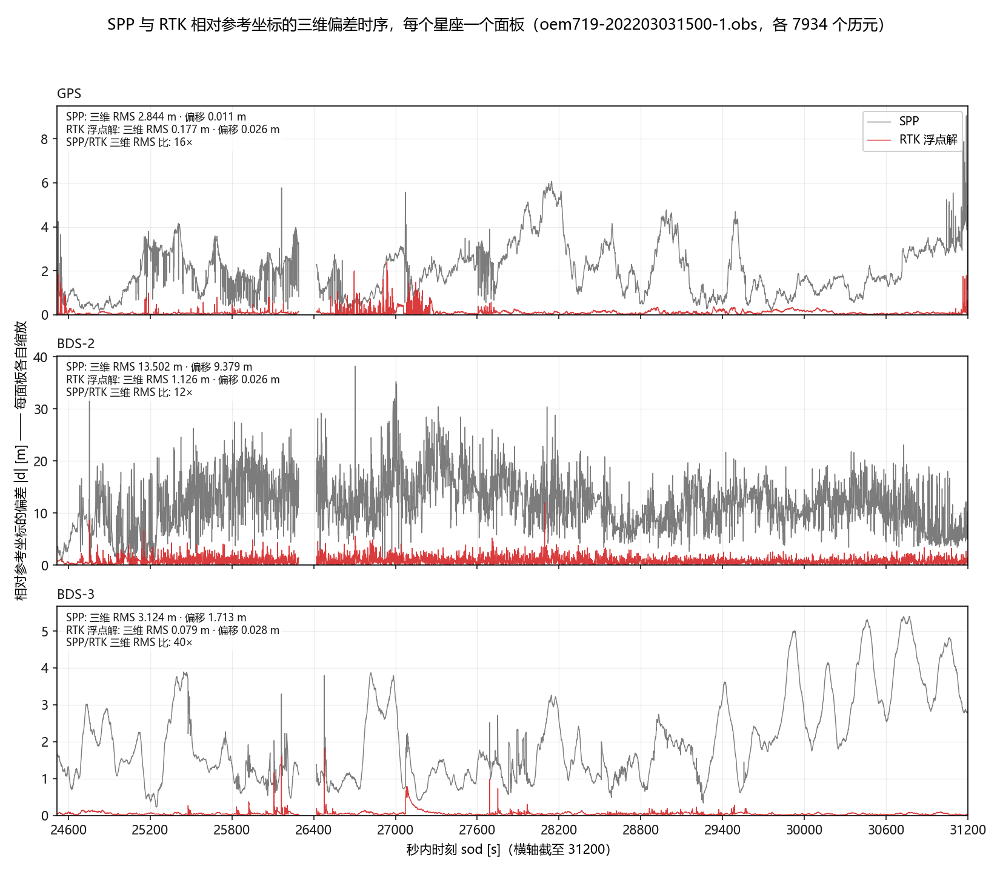

**图 8-1**　SPP 与 RTK **相对参考坐标**的三维偏差时序，每个星座一个面板（上起 GPS、北斗
二号、北斗三号），纵轴**线性（真实数值，全章不用对数轴）**、三个面板共用同一窗口。灰线为 SPP，红线为 RTK 浮点解，两条线
都是**原始结果**（没有做任何扣除或缩放）；面板左上角给出各自的**三维 RMS 与偏移量**，
最后一行是上表最右列那个比值。三条 SPP 带子落在 2.8–13.5 m，三条 RTK 带子落在 0.08–1.13 m。

**这张图画的是什么。** 横轴是当天秒内时刻 sod，**每个点是一个历元的三维位置偏差**
|d| = √(E²+N²+U²)，坐标框架是站心 ENU、参考是基准站表头坐标——与上表同源，面板上的数字
就是 `rtk.error_stats` 的那几个返回值，不另算。**纵轴是线性的**，读的是真实米数：两列
相差 12–40 倍，所以 RTK 那条线就压在坐标轴上，而**这个高度差本身就是这张图的结论**。
三个面板共用同一窗口同样是为了可比——各自缩放会让北斗二号的 1.13 m 与北斗三号的
0.079 m 看起来一样。曲线被压扁时靠**每个面板左上角的数字**读数：两列的偏移与 RMS 都写在
那里，高度只是形状。

**横轴截到 sod 31200，不是 run 就到那里。** 这段数据一直记到 32578，最后 1378 个历元不画：
那一截里单点解明显变差（GPS 的三维 RMS 由 2.84 m 涨到 4.54 m，北斗二号由 13.50 m 涨到
16.48 m、最大 51 m），是主动截掉的，不是数据到那里就没了。**只截画出来的曲线，不截面板上
的数字**——bias / σ / RMS 仍是整个 7934 历元上的值，与第四节上表同源。横轴标签因此写明
「横轴截至 31200」，免得一段短的曲线被读成一次短的 run；图 8-1b/c/d 也截在同一处。

**读这张图要带两个前提**，它们分别写在面板的「偏移」那一项上：

1. **参考坐标是我们定出来的真值，不是接收机报的那个**。图上每个点都是「离这个坐标多远」；
   真值的做法与证据见本节末「参考坐标是怎么定出来的」。
2. **RTK 那一列贴近零是构造性的**。`apps/rtk.cpp:866` 写的是 `rtk: = xyzRover + dxyzRTK`，
   而双差解就是把流动站对齐到**基准站**，基准站的位置在解算里就是我们交给它的那个坐标
   ——也就是参考坐标本身。所以那 0.026–0.028 m 是**双差自身的残差**（零基线上真值确实是
   0），不是「RTK 精确到 3 cm」的证据。

**「残余」不等于「噪声」。** 面板上的「偏移」是两列各自的均值离参考有多远（GPS 0.01 m、
北斗二号 9.4 m、北斗三号 1.7 m），扣掉它再看同一批数据，回答的是另一个问题——
**各自的重复性有多好**；图 8-1 仍然只画原始结果，那一问的数这里只给数字：

- 去均值后的残余 RMS：SPP 2.844 / 9.713 / 2.612 m，RTK 0.176 / 1.126 / 0.074 m，比值
  **16× / 9× / 35×**；
- 而残余里**又主要是漂移**：实测 GPS 的 SPP 垂直误差，把 2.2 小时分成 8 段、各段均值依次是
  −1.3、−1.6、−1.6、−3.0、−0.8、+0.5、+3.4、+4.3 m——**首尾差 5.6 m、起伏 7.3 m**（先降
  后升，不是单调漂）；而同一列逐历元的垂直 σ 只有 0.38 m。三个星座性质还各不相同：GPS 以
  漂移为主，北斗二号是真噪声大（逐历元 6.1 m），北斗三号也是以漂移为主（逐历元 0.19 m）。

把「逐历元的量」单独取出来（一次差分，漂移自动消掉），才是噪声对噪声：

| | 原始 RMS 比（图上标的） | 去均值后残余比 | 逐历元（≈噪声）比 |
|---|---|---|---|
| GPS | 16× | 16× | **3.7×** |
| 北斗二号 | 12× | 9× | **5.1×** |
| 北斗三号 | 40× | 35× | **3.3×** |

所以三个星座的**噪声**其实都在 3–5 倍这个量级，16× 与 40× 的悬殊主要来自漂移。这条 5.6 m
的慢漂移本身，也是第十二节那个未解偏移留下的最有用的线索：它是一个**慢变量**，与
「常数偏差」需要不同的解释（对流层已被排除——第十二节）。

四条结论：

1. **三个比值得分清**，它们回答三个不同的问题：原始 RMS 比 12–40×（上表最右列、图 8-1
   面板上标注的那个）说「离参考坐标差多少」；去均值后残余比 16 / 9 / 35× 说「去均值后残余
   差多少」；逐历元比 3.7 / 5.1 / 3.3× 才是「噪声差多少」。三个数都比以前小，是因为这一节
   现在用的是**打开对流层改正、GPS 用精密轨道与钟差**的那套配置（见本节末）——单点定位
   已经到了它作为"纯码解"该有的水平，再往下要靠在载波上做文章（第八、十节）。
2. **三种配置一律是垂直方向最差**：U 轴的 σ 都比水平两个方向大 2–4 倍
   （GPS 0.164 vs 0.048/0.038；北斗三号 0.065 vs 0.026/0.023）。
   这是卫星几何本身决定的——垂直方向没有可用的几何约束，三个配置都逃不掉。
3. **北斗三号在三个方向上都最好**：中位误差 3.8 cm，比 GPS 的 8.2 cm 好一倍多，
   水平 σ 只有 26 mm / 23 mm。
4. **北斗二号差一个数量级**：中位 0.672 m，最坏 12 m，U 轴 σ 达到 1.04 m。

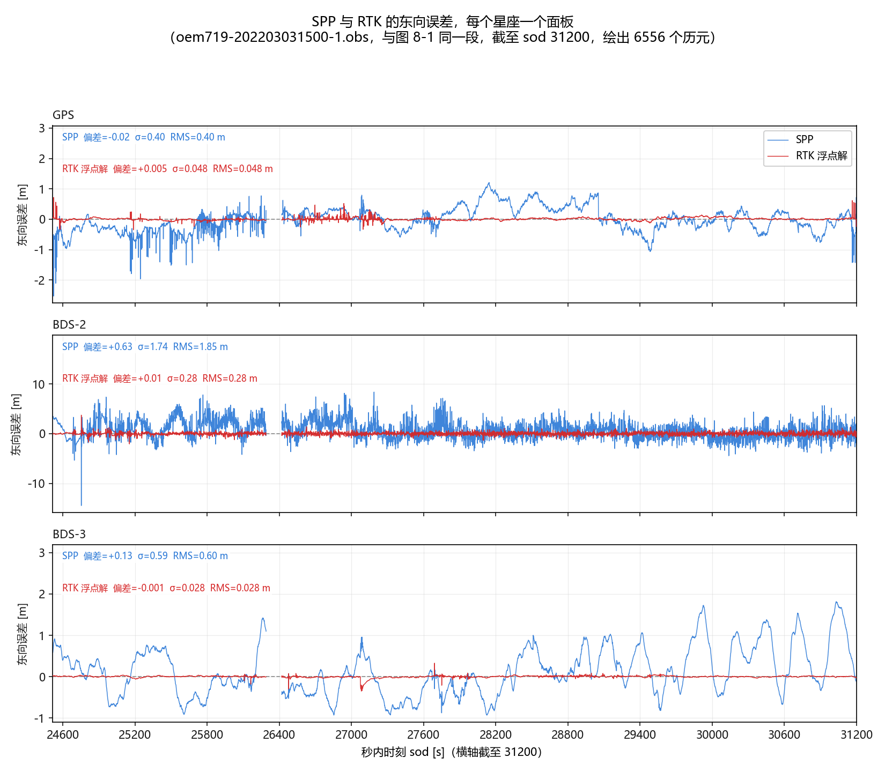

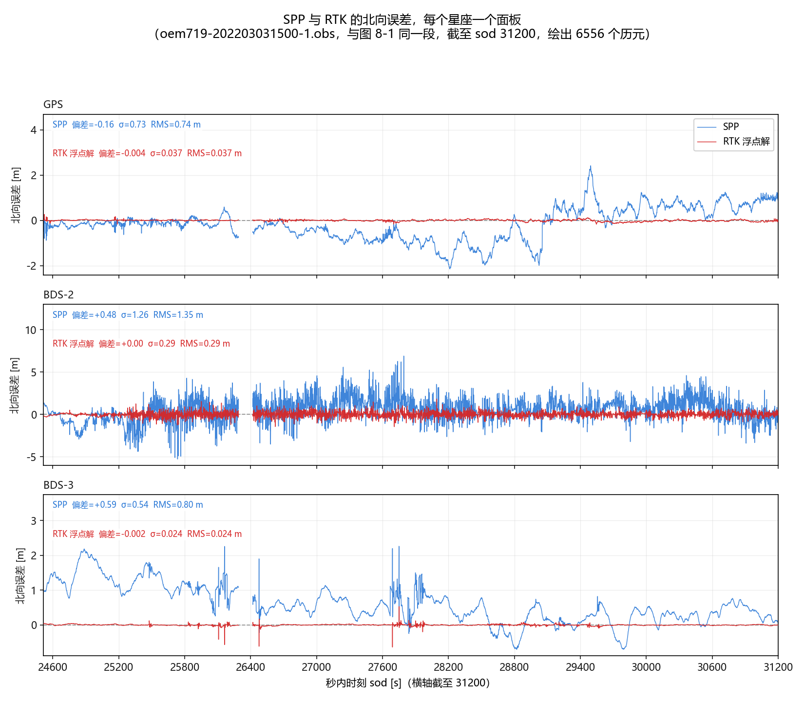

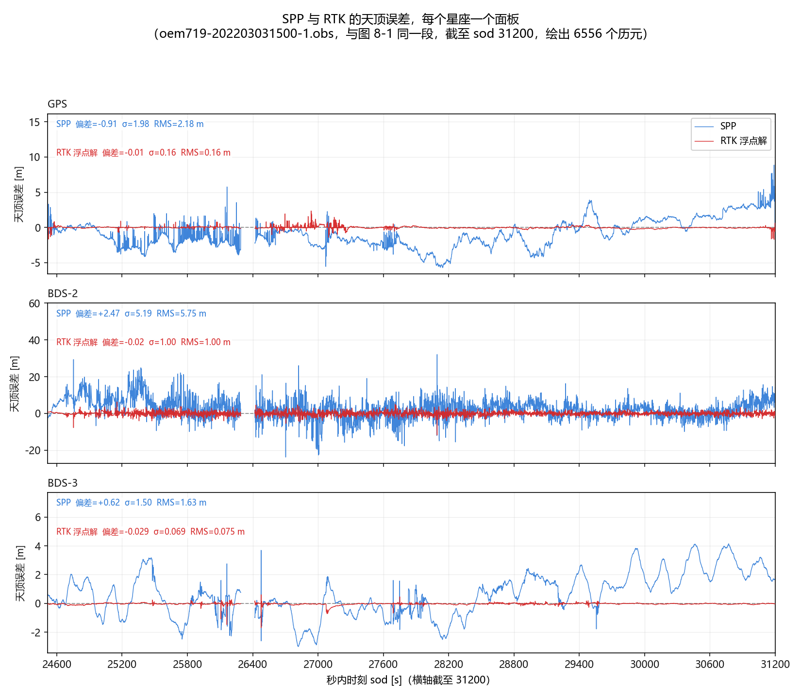

**图 8-1b / 8-1c / 8-1d**　图 8-1 **按方向拆开**的三张，三张依次是**东向、北向、天顶**：
同一批数据、同样三个星座（一张图一个星座一个面板），**画的历元与图 8-1 一模一样**——同起
同止、同样截至 sod 31200，**6556 个历元、不抽稀、每个历元都画**。

**两条曲线仍然同面板、共用一根纵轴。** 蓝 = SPP，红 = RTK 浮点解。纵轴是**带符号的误差**：
虚线是零，曲线在零上方就是在参考的**正方向那一侧**（东向图里是偏东、北向图里是偏北、天顶图
里是偏上），不是"偏了 0.4 m"——父图 8-1 画的是三维误差的**模长**，带不了符号，**能读出符号
是这三张图唯一多给的东西**。给两条各一根轴是不行的（拆分版的教训：那样"两者差 12–40 倍"这个
量就再也读不出来，而那正是本章反复澄清的东西——一列绝对解、一列相对解，见第四节说明 2）。
一根同轴担不动的正是这个倍数，于是交给**每条曲线自己左上角的 bias / σ / RMS**；比值仍在
图 8-1、第四节的上表和报告里。

**为什么按方向拆成三张。** 三个方向的量级差一个数量级——同一段里北斗二号的 SPP RMS 是东向
4.52 m、北向 4.73 m、**天顶 10.99 m**；挤在同一根轴上，东向那条就被压成一条贴轴的线。拆开
之后每张各自展开一个方向，而三个星座仍然共用该方向的那根轴（这是要保留的比较）。

| 与图 8-1 同段（截至 sod 31200，6556 个历元）的 RMS | 东向 | 北向 | 天顶 |
|---|---|---|---|
| GPS：SPP / RTK | 0.400 / 0.048 | 0.744 / 0.037 | 2.180 / 0.162 |
| 北斗二号：SPP / RTK | 4.520 / 0.280 | 4.729 / 0.293 | 10.989 / 0.998 |
| 北斗三号：SPP / RTK | 0.796 / 0.028 | 0.500 / 0.024 | 2.137 / 0.075 |

（单位 m，与图上每条曲线左上角那一行同源、同口径。天顶那一列的**偏差**是这三张图里最显眼的
东西：SPP 在 GPS 上是 −0.91 m、北斗二号 −7.68 m、北斗三号 +0.95 m，而同一列逐历元的 σ 只有
1.98 / 7.86 / 1.91 m——第四节第 3 条说过，SPP 的残余里主要成分是漂移，而漂移是慢变量。而且
这个偏差在画的这一段里**穿过零**：GPS 从 sod 28000 前后的 −2.6 m 爬到末段的 +2.1 m，北斗三号
从 −0.7 m 到 +3.5 m。画模长的图 8-1 读不出这个符号，这三张读得出。）

**图 8-1 本身也截在同一处**（见它的图注）：父图画模长、这三张画带符号的分量，四张说的都是
同一批历元。

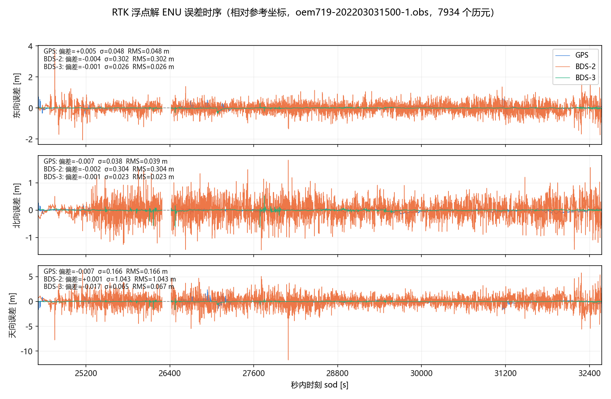

**图 8-2**　三个星座的 E / N / U 误差时序，三个面板分别对应三个轴。
与图 8-1 对照读：图 8-1 里合成一条红线的 RTK 解，在这里被拆成东、北、天顶三个方向，
天顶那一条明显最宽——这就是结论 2 的图形依据。

> **ECEF 与 ENU 不要混用。** 本文初稿曾把 ECEF 三轴标准差标成 ENU，
> 于是「GPS 的 Y 轴 σ 最大（0.136）」被读成了「北向最差」，而旋转到站心之后
> 北向其实是 0.038、最差的是天顶 0.164——结论正好相反。
> ECEF 的 `dY` 混合了北向、东向和天顶三个分量，它在数值上偏大说明不了任何方向的问题。
> `gnss_plot.rtk` 因此把 ENU 作为标注的坐标框架，ECEF 值另列一行并明确标出。

### 关于「偏差」这一列：两列的偏差不是一回事

上表没有单列偏差，因为它在两列里的含义不同，合在一起讲会误导。

**RTK 那一列**的 ENU 偏差是 GPS `(+0.005,-0.008,-0.024)`、北斗二号
`(-0.004,-0.001,-0.026)`、北斗三号 `(-0.001,-0.001,-0.028)` 米——都在 3 cm 以内。但这个
小是**结构性的**（见第 3.3 节与图 8-1 的图注：双差把流动站对齐到基准站，而基准站的位置
就是解算时交给它的那个坐标，也就是参考坐标本身），所以**零基线数据上的小偏差不构成
「这个模型没有系统差」的证据**。

**SPP 那一列**的偏差是另一回事：ENU 上是 GPS `(-0.009,-0.001,+0.005)`、北斗二号
`(-2.791,+4.317,-7.844)`、北斗三号 `(+0.273,+0.369,+1.651)` 米，模长
**0.011 / 9.379 / 1.713 m**。**这才是上表「SPP 3D-RMS」那一列的主要成分**，见结论 1。

**因此「SPP/RTK 比值」不是与参考无关的指标。** 本文初稿写过「两列都对同一个基准站表头
取差，基准偏差在比值里抵消，所以最右列才是无保留的结论」——那句话是错的。两列确实对齐
同一个坐标，但**其中一列是被构造性地钉在那个坐标上的**（RTK 那一列），另一列是自由的
单点解，所以比值里那一列自带的分母不是「两种技术的公平较量」。最右列是一个参考相关的数，
要连同这个前提一起读——图 8-1 的面板把两列各自的偏移量印出来，就是为了让它可读。

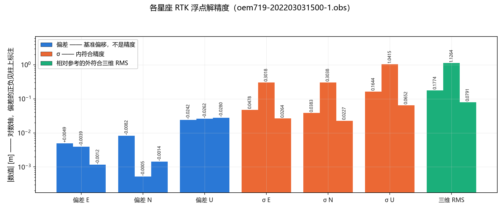

**图 8-3**　上表七项量的柱状图版本，按星座分组、按偏差／σ／三维 RMS 三类上色；
纵轴取绝对值、**线性**，偏差的正负标在柱顶（原因见本节开头）——毫米级的偏差柱几乎看不到高度，但每根柱子都带自己的数值。

### 零基线这个前提要说清楚

零基线（两台接收机接同一天线）意味着星历误差、电离层、对流层、多路径在站间差分里
几乎精确抵消。所以上表度量的是**双差之后剩下的伪距噪声与多路径差异**，
**不能直接推广**成「GPS RTK 和北斗 RTK 在一般基线上的精度」。要那个结论需要一套
几十公里基线的数据。

---

### 参考坐标是怎么定出来的

两台接收机报出的表头坐标互相只差 **0.070 m**，却**一致地离天线 24.9 m**。上面那张表
之所以不采用它、而用真值当参考与基准，就是因为这 24.9 m——**它是接收机报的那个坐标的错，
不是单点定位的精度**（早先版本的表与图上 SPP 那一列 19–28 m 的数值，主要就是这个偏置）。
怎么知道的：

1. **同一套解算，在真值已知的数据上是 1.06 m。** 2025-01-01 的武汉 IGS 站（`data/` 里那套
   30 s 数据）有官方坐标可查，同一套 `rtk` 单点解算对它的整段均值偏差是 **1.06 m**、3-D RMS
   4.94 m；
2. **两台接收机各自解，结果互差 0.020 m。** 用**精密轨道与钟差**（`--sp3/--clk`，CODE 2022-03-03
   的产品）分别解流动站文件与基准站文件，整段均值差 **0.020 m**——同一天线，这个自洽性
   与两表头的 0.070 m 一致，但两表头都整体偏了 24.9 m；
3. **广播解与精密解互差 1.70 m。** 也就是说广播星历那点误差（1–4 m）不是问题，
   偏 25 m 的是坐标本身。

所以这两台接收机在记录时用的那个坐标（`RTKCONV` 从原始日志里带出来的）**不是天线的真实
位置**。本文因此不采用它，而用精密解定出的 `(-2267803.4464, 5009342.4841, 3220991.0095)`，
通过 `rtk --base-xyz X,Y,Z` 交给解算（双差就是相对这个基准解的）。真值本身的不确定度
由第 1 条界定在 **~1 m**。

**这张表用的配置**：三种模式都加 `--trop`（对流层改正）与 `--base-xyz`；北斗两种另加
`--bds-tgd`（TGD），**GPS 还用了精密轨道与钟差**（`--sp3`/`--clk`，CODE 2022-03-03 的产品）。
三个杠杆各自的贡献（GPS，对同一批历元）：

| 配置 | 均值偏差 | 三维 RMS |
|---|---|---|
| 章节原配置（表头当参考、广播星历、无对流层）| 19.47 m | 21.36 m |
| ＋真位置 | 7.13 m | 11.31 m |
| ＋`--trop` | 1.04 m | 9.25 m |
| ＋精密轨道与钟差 | **0.01 m** | **2.84 m** |

**为什么 GPS 用精密产品而北斗没有**：手上的 CODE 产品（`COD21994.*`）不含北斗钟差，
所以 bds2/bds3 只能留在广播星历上——它们的 SPP 那一列因此是"广播 + 对流层 + TGD"的结果
（13.5 / 3.1 m），比 GPS 那 2.84 m 保守。**RTK 那一列基本不受这个区别影响**（双差把
卫星端误差抵消掉了）——第五节里两种北斗一代与二代的十五倍差距在换配置前后都成立；
要拿到北斗的精密解，需要 MGEX 版本的轨道与钟差（`COD0MGXFIN_…`）。

**2026-10-13 补：MGEX 产品下到了，但直接换进去北斗会更差——是 DCB，不是产品。**
GFZ 的 MGEX 产品（`data/GBM0MGXRAP_20220620000_01D_05M_ORB.SP3` 与 `…_30S_CLK.CLK`，
2022-03-03 = 第 062 天，SP3 里含 `C01…C60` 全部北斗）读入器直接认，不用改表头。实测 SPP 三维 RMS：

| | 广播（现状） | GFZ 精密 |
|---|---|---|
| 北斗三号 | 3.124 m（偏差 1.713、散布 2.61） | **6.176 m**（3.534、**5.06**） |
| 北斗二号 | 13.502 m（9.379、9.71） | **20.751 m**（12.143、**16.83**） |

**对照组证明产品本身没问题**：同一份 GBM 解 GPS 是 **2.878 m**，而 CODE 的 `COD21994` 是
2.844 m（差 0.03 m）。所以退化是北斗特有的；而 `--bds-tgd` 加不加**逐位相同**——说明那条路
根本没在动这件事。

**根因是 DCB 不匹配，不是基准偏移。** 判据是**散布也变大了**（北斗三号 2.61 → 5.06 m）：
一个常量的基准偏移只会平移、不会放大散布；散布同时变大意味着**每颗星的偏差各不相同**。
GFZ 的北斗钟差按 **B1I/B3I 无电离层组合**定基准，广播钟差是 **B3I 基准 + TGD**，
按广播那套约定去用精密钟差，每颗星就各差一个属于自己的 DCB。

**要修得先有 OSB/DCB**：镜像上有 `GBM0MGXRAP_20220620000_01D_01D_OSB.BIA.gz`（SINEX-BIAS），
但代码里**没有它的读入器**——读入 + 挂到逐卫星码观测上 + 测试，是一道习题的量级（见第十二节）。
**在它做好之前，北斗那两列保持广播是对的**：广播 + TGD 至少自洽。

**单点定位到此为止**：上表最后一档 2.84 m 是"纯码解"的现实水平（第六章那 2.76 m 是同一
量级，且是更短窗口上的离散度）。**再往下必须用载波**——第八节的固定解是 0.011–0.030 m、
第十节的卡尔曼浮点解是 0.024–0.106 m，那才是相位真正约束坐标之后的结果。


## 五、北斗频点的陷阱：B1I+B2I 只覆盖北斗二号

这一节是本轮最容易出错的地方，也是最初选错频点的地方。

### 5.1 两代北斗不播同一个第二频点

实测（`data/Zero-baseline`，历元 1 的原始 RINEX）：

| | B1I (`C2I`) | B2I (`C7I`) | B1C (`C1P`) | B2a (`C5P`) |
|---|---|---|---|---|
| 北斗二号 `C01`–`C16` | ✓ | ✓（GEO 除外） | ✗ | ✗ |
| 北斗三号 `C19`+ | ✓ | **✗** | ✓ | ✓ |

北斗二号播 B2I，**北斗三号不播**；北斗三号播 B2a，北斗二号不播。
所以 `B1I+B2I` 和 `B1I+B2a` **互不包含**，选前者会把整个北斗三号排除掉。

### 5.2 代价

两种配置在零基线上都得到 **6 颗**卫星，但构成完全不同：

- `bds2` → 6 颗**北斗二号**，以 IGSO 为主，全部挤在亚太上空，方位分布差；
- `bds3` → 6 颗**北斗三号**，全是 MEO，几何分布与 GPS 可比。

结果就是第四节里 1.126 m 与 0.079 m 的差距——**同样的解算代码、同样的 6 颗星、
差 14 倍**，差别只在几何构型与星历质量。

> **第九节回看这一节**：两代该分开跑，这一点结论没错，但理由不是"接收机钟差有
> 系统差"——实测那个差只有 −1.2 cm，即零。理由是**频点不兼容**：没有任何一对
> 频点能覆盖两代。见 9.4 第 2 条。

> 最初的判断错误在于：为了与第 7 章 `detectCSMW` 的北斗频点保持一致而选了 B1I+B2I，
> 但没有先查数据里两代北斗各播什么。**`detectCSMW` 用 L2/L7 是有历史原因的
> （它就是那么建的、也就那么验证的），不构成 RTK 也必须用同一对频点的理由。**
> 代码里 `app_utils.h` 的 `rtkModes()` 与 `cycleSlipObsTypes()` 现在是两张独立的表，
> 头文件注释写明了**不要合并**。

### 5.3 顺带说明：`C6I`（B3I）在这份数据里不存在

`apps/spp_if.cpp` 的北斗 IF 组合用的是 `C2`/`C6`（B1I/B3I）。但零基线数据的北斗
类型表里**没有 C6I**，所以在这份数据上 `spp_if` 的北斗一路是空转的。
这不是本轮引入的问题，也不影响 `spp_if` 的冻结基线（那份基线用的是 `data/sample/`
的另一套数据）——**但如果将来拿这份数据去验 `spp_if` 的北斗，会得到空结果。**

---

## 六、粗差诊断：验后残差是最有价值的一个数

仓库里原本**没有任何地方检查拟合好坏**——`SolverLSQ::solve` 算完状态向量就结束了。
好处是快，坏处是**一个坏历元和一个好历元从输出文件上看一模一样**。

`apps/rtk` 因此自己算两个量写进 `_rtk_diag.csv`：

```
sigma0  = sqrt( Σ wᵢvᵢ² / (nObs − nUnk) ),   v = H·x − prefit
```

用锚点窗口（25 历元）举例，两个已知的坏历元被干净地挑出来：

| sod | `rank`/`nUnk` | `cond` | `sigma0` |
|---|---|---|---|
| 24517–24523 | 15/15 | 27.95 | 0.045 – 0.071 |
| **24524** | 17/17 | 27.98 | **1.374** |
| 24525–24540 | 15/15 | 27.96 – 27.99 | 0.043 – 0.070 |
| **24541** | 17/17 | 28.01 | **1.103** |

其余历元的 σ₀ 在 0.04–0.07 之间，这两个历元跳到 1.1–1.4，**差 20–30 倍**。
两处都是多了一颗星（`nSDsats` 7→8、方程 24→28），解随之跳了 1.4–1.8 m。
全量 7934 个历元里，σ₀ 超过中位数 10 倍的历元数为：GPS 47、北斗二号 1、北斗三号 9。

`rank` 与 `cond` 两列的作用是另一回事：**秩亏不会抛异常，只会给出一个看起来合理的错解**，
`examples/diff_station` 的第二个例子专门演示这一点（12 个方程、9 个未知数，
两颗星视线重合时秩从 9 掉到 8）。实测三种配置在全量数据上**每个历元都满列秩**，
条件数约 28。

---

## 七、回归基线：为什么只有 `rtk:` 一列能严格对拍

`data/Zero-baseline/oem719-202203031500-1.obs.rtk.lsq.out` 是**原版 gnssLab-2.2
程序**在同一条基线上的输出，25 个历元，恰好等于 `--stop 2022-03-03T06:49:00` 的窗口。
这是一个真正的外部锚点：独立的实现、若干年前跑的、同样的输入。

实测：

| 对比项 | 结果 |
|---|---|
| `rtk:` 列 | **25/25 个历元逐字节相同** |
| `spp:` 列 | 最坏差 9.6 m |

`tests/test_rtk_float_regression.py` 因此对 `rtk:` 列做**逐字节断言**，对 `spp:` 列
给 15 m 容差，并在测试里写明原因。

**为什么 `spp:` 列对不齐**：单点解里每条相位方程都带一个自由模糊度，法方程在这些
方向上奇异，`inverse()` 把舍入噪声放大——同一个源码的两个不同构建彼此能对上最后一位，
不同构建之间差几米。双差解会把位置重新参考一次，所以 `rtk:` 列稳定而 `spp:` 列不稳定。
这不是待修的 bug，是参数化本身的病态；要根治得给单点解加模糊度基准约束。

**基准站那颗"已知坐标"是怎么来的**：默认取基准站 RINEX 表头；给了 `--base-xyz X,Y,Z`
就是那个值（本章的表与图都用真位置覆盖它，见第四节末）。`SPPUCCodePhase::solve` 对这个
基准站 `linearize` 之后就 `break`（位置已知，不迭代），而流动站迭代到 `dxyz.norm() < 0.1`
就停（注意 `SPPIFCode.cpp` 的对应阈值是 `0.01`，这条路松十倍）。推出
`xyzRTK = x_base0 + dxyz_lastSPP`——所以输出复现的是**那个基准坐标**加上流动站最后一次
未收敛的改正。这也是偏差列不能当精度用的原因（第四节）。

---

## 八、习题 2：模糊度固定，以及北斗二号与三号

教材原文：

> 【习题 2】考虑到北斗 2 和北斗 3 的接收机钟差存在系统差，请分析在 RTK 定位中，
> 将北斗 2 和北斗 3 分开后浮点解和固定解定位效果。

本节做的是「固定解」这一半；「混解 / 分开」那一半在第九节。

### 8.1 做了什么

`rtk --fix` 在每个历元最小二乘解完之后接上教材 8.3.5 的五步：

| 步 | 教材式 | 本仓库的实现 |
|---|---|---|
| 浮点解与协方差 | (8.49) | `SolverLSQ::getState()` / `getCovMatrix()` |
| 降相关 + 序贯搜索 + Ratio | (8.50)–(8.61) | `src/ARLambda.cpp`（MLAMBDA） |
| 整数回代坐标 | (8.63) | `GnssFunc.cpp` 的 `fixSolution()` |

后两个函数**在本仓库里一直存在、也一直没人调用**。接线的先决条件是先修掉它们身上的
四个缺陷，其中三个在失败路径上，最严重的一个是：**搜索失败时返回"成功"**——
`lambda()` 吞掉错误码后 `return 0`，而调用方的固定解矩阵 `F` 从未被赋值；
又因为搜索失败时残差平方和被留在零，算出来的 ratio 是 **9999.9**，
也就是**数据越差，越宣称自己最可靠**。另有一个遮蔽 bug 让搜索的迭代上限守卫
（`if (c >= LOOPMAX) return -1`）永远不触发。修之前，秩亏协方差会让程序**段错误**；
修之后返回浮点解、ratio 记 0。

`ARLambda` 的正确性有**外部锚点**：教材例 8-1 的同一组数据，本实现给出
`[−9 21 −2 4 24 7]`、ratio `6.51682`，与教材逐位相同，见
`examples/exam-8.3-lambda.cpp`（目标 `mlambda`）与 `tests/test_lambda_resolve.py`。

**阈值只影响标注，不影响写出的坐标**：被拒历元写进固定解文件的是**浮点解**
（`fixSolution` 在搜索失败时返回的 `dxyzFixed` 就是浮点增量）。所以固定解文件必须
按 `ratio` 或诊断 CSV 的 `fixed` 列过滤后才能用——这也是下面第 3 条结论的由来。

### 8.2 结果

零基线 7934 历元，真值严格已知（两台接收机共用一个天线）。「固定 RMS」只统计
ratio > 3 的历元，「提升」= 浮点 RMS ÷ 固定 RMS：

| 配置 | 浮点 3D-RMS | 固定率 | **固定 3D-RMS** | **已接受的最坏误差** | 提升 | ratio 中位数 |
|---|---|---|---|---|---|---|
| GPS L1/L2 | 0.177 m | 100.0% | **0.0180 m** | **39 mm** | 10× | 510 |
| 北斗二号 B1I/B2I | 1.126 m | 82.1% | **0.0304 m** | **82 mm** | 37× | 102 |
| 北斗三号 B1I/B2a | 0.079 m | 100.0% | **0.0114 m** | **19 mm** | 7× | 1287 |

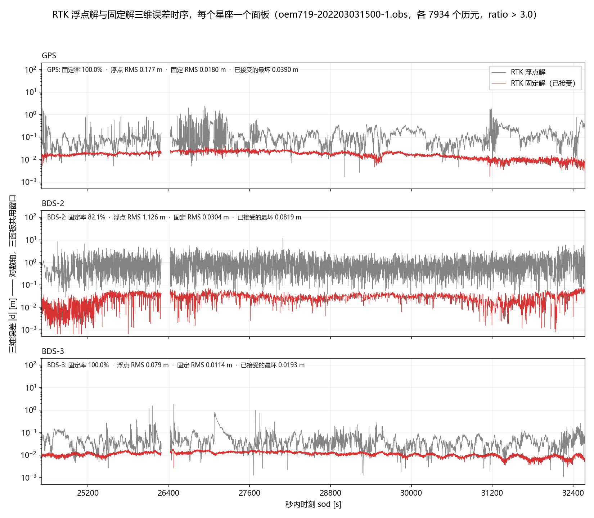

**图 8-4**　浮点解（灰）与**被接受的**固定解（红）三维误差时序，纵轴**线性**、
三面板共用与图 8-1 相同的窗口。灰带的高度就是图 8-1 里 RTK 那条线的高度，
两图可以直接对照读：灰与红之间的距离就是固定买来的东西。红色只在 ratio 通过处绘制，
**不在被拒历元上插值或回落到浮点值**——因为消费者在那些历元上拿到的确实是浮点解。
北斗二号面板上红带的断续，就是那 17.9% 固定不了的历元。

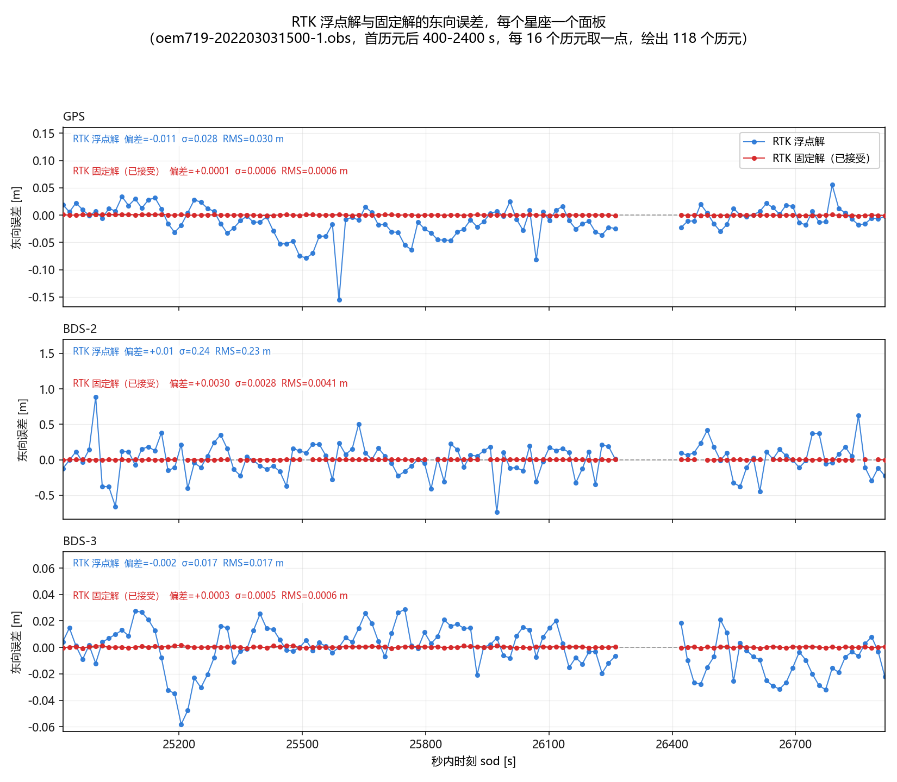

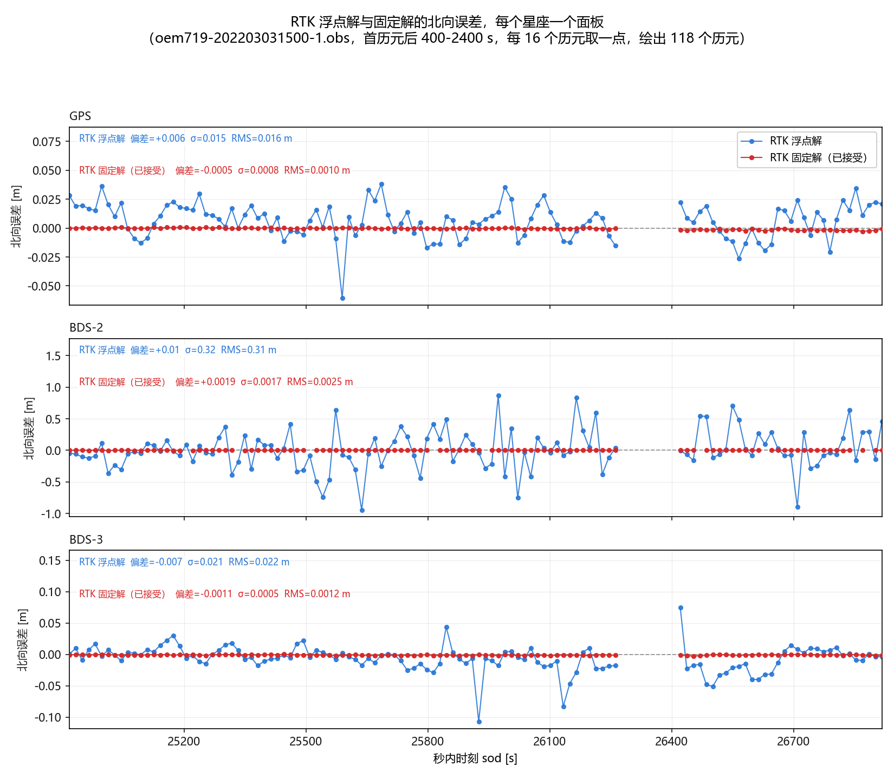

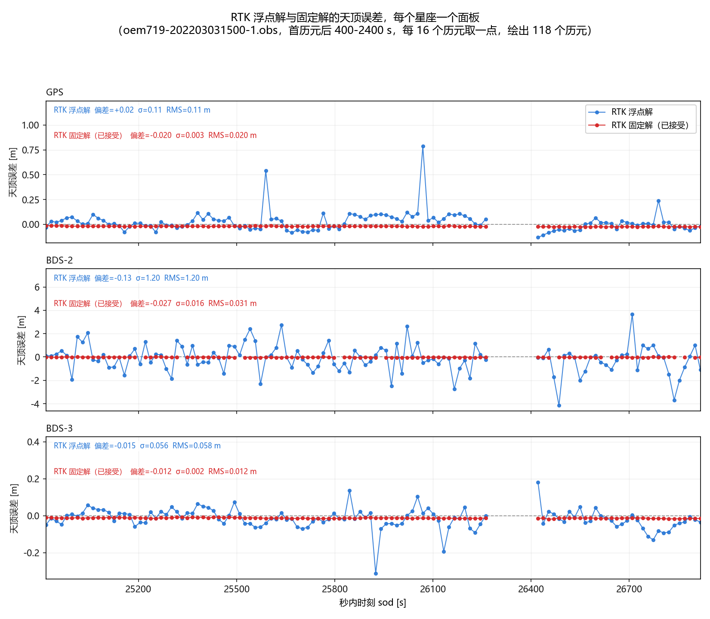

**图 8-4b / 8-4c / 8-4d**　图 8-4 的**放大版**，三张依次是东向 / 北向 / 天顶：只取首历元
之后 **400–2400 s**（**118 个历元，每 16 个取一点**）。蓝 = 浮点解，红 = **被接受的**固定解，
两条同面板、共用一根纵轴。红色只在 ratio 通过处绘制，被拒的历元是**断口**——不是插值，也不是
回落到浮点值，因为那正是消费者在那些历元上真正拿到的东西。窗口比另外两组宽，就是为了让
北斗二号的拒收显示成**反复的断口**而不是一小撮。

**这一组是固定解自己的形状第一次被画出来。** 图 8-4 把两条画在同一根轴上，而轴是按浮点解定
的，于是固定解落在面板高度的 **0.2–0.5%**（北斗二号实测）——比坐标轴本身还细，它一直是被
**断言**的，不是被**画出来**的。这一组里一根同轴仍然装着两条，但**方向一拆已经先替纵轴省掉
一个数量级**，红色的粗细、起伏和断口就都留得住了。

| 窗内 RMS（首历元后 400–2400 s，118 个历元） | 东向 | 北向 | 天顶 |
|---|---|---|---|
| GPS：浮点 / 固定 | 0.030 / 0.0006 | 0.016 / 0.0010 | 0.107 / 0.0203 |
| 北斗二号：浮点 / 固定 | 0.235 / 0.0041 | 0.314 / 0.0025 | 1.198 / 0.0309 |
| 北斗三号：浮点 / 固定 | 0.017 / 0.0006 | 0.022 / 0.0012 | 0.058 / 0.0123 |

（单位 m。**"固定解好了多少倍"在这三张图上仍然读不出来**——那是图 8-4 和第八节表格的事。
窗内固定率 100% / 92.4% / 100%，比整段的 100% / 82.1% / 100% 高，这 33 分钟是北斗二号表现
较好的一段；它天顶那个 0.0309 m 也是上表六个固定值里最大的一个。）

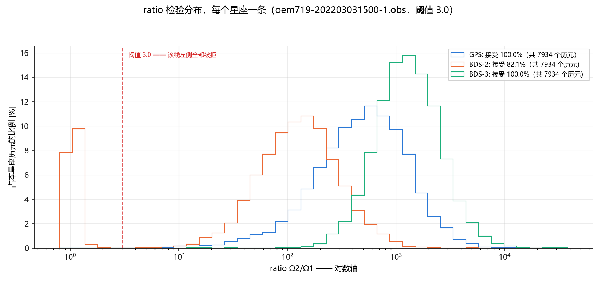

**图 8-5**　三个星座的 ratio 分布，纵轴是本星座历元的比例（便于比较），横轴对数，
红色虚线是阈值 3。北斗二号的分布整体左移且明显更宽，阈值左侧那一堆就是被拒的历元。
横轴取对数是因为 ratio 跨了五个数量级；而这张图真正要看的正是**左侧尾部**。

三条结论：

1. **ratio 通过即正确。** 三个配置「已接受的最坏误差」分别是 39 mm / 82 mm / 19 mm，
   **没有一个固定错**。这是整个方法能不能用的前提，也是这一节最该记住的数。
   （固定解的三维 RMS 是 18 / 30 / 11 mm，比浮点解好 **7–37 倍**——不是两三个数量级：
   它继承了浮点解那 2–3 cm 的基准偏移，见第四节第 2 条注与图 8-4 的灰红间距。）
2. **精度提升 7–37 倍，来源是相位终于开始约束坐标。** 单历元浮点解里相位对坐标的
   信息量恰好为零（第三节的数学证明）；一个整数约束去掉每条相位方程的一个自由度，
   相位的厘米级甚至毫米级信息才进得来。北斗二号的 37× 最高，恰恰因为它的浮点解最差。
3. **ratio 检验不是装饰，它是有代价地买来的。** 北斗二号拒掉 1423 个历元（17.9%）。
   如果**不按阈值过滤**直接采用固定解文件，其中 **1310 个历元（16.5%）** 会落在
   1 m 到 25 m 的误差上——它们是被拒历元上残留的浮点解。换句话说：固定解文件里
   混着两种东西，过滤之前不能读。

### 8.3 为什么没有上卡尔曼

出方案时我预计单历元模糊度精度不够、固定率会很低，理由是模糊度浮点解的精度被
伪距驱动的坐标卡住（σ_N ≈ 坐标误差 / λ ≈ 0.2–0.5 周）。**实测把这个预判推翻了**：
GPS 与北斗三号 100% 固定，ratio 中位数 510 与 1287。零基线上双差伪距比预想的精确得多，
模糊度浮点解好了一个量级。

所以教材 8.3.4 的卡尔曼（跨历元传模糊度、把 σ_N 压到 0.05–0.1 周）
**在 GPS 与北斗三号上没有收益空间**，只有在北斗二号那 17.9% 上可能有。这是"先做 A 再评估 B"
里"评估"的结论：**现阶段不必上卡尔曼**。

### 8.4 复现

```bash
SP3="data/COD21994.EPH"   # CODE 精密轨道（不含北斗）
CLK="data/COD21994_rnx3.CLK"   # 对应的精密钟差（RINEX 3.02）
TRUE="-2267803.4464,5009342.4841,3220991.0095"
# 固定解（每配置约 25 秒），落到与第十三节同一棵树里
./build/bin/rtk config/rtk.ini --sys gps  --fix --trop --sp3 $SP3 --clk $CLK --base-xyz $TRUE --out-dir output/rtk/full
./build/bin/rtk config/rtk.ini --sys bds2 --fix --trop --bds-tgd --base-xyz $TRUE --out-dir output/rtk/full
./build/bin/rtk config/rtk.ini --sys bds3 --fix --trop --bds-tgd --base-xyz $TRUE --out-dir output/rtk/full

# 数字表 + 六张全时段图 + 九张按方向拆开的孪生图（图 8-1…8-5 及 8-1b/c/d、8-4b/c/d；
# 8-1b/c/d 画的就是图 8-1 那一段，8-4b/c/d 截一段中段，8-6b/c/d 截开头那 400 s）
# 8-4 与 8-4b/c/d 需要上面这一轮 --fix 的输出。图 8-6/8-6b/c/d 要的是第十节那棵卡尔曼树，
# 图 8-7 要的是第十一节那棵 --dd-cov 树，见第十三节）
gnss rtk-plot --out-dir output/rtk/full --ref-xyz="$TRUE" --lang zh

# 教材例 8-1：三种结局（正常固定 / ratio 被拒 / 协方差不可用）
./build/bin/mlambda
python tests/test_lambda_resolve.py
```

---

## 九、习题 2（续）：北斗二号与三号的混解，与那个"系统差"

第八节做的是习题 2 的"分开后浮点解和固定解"；这一节是题目前半句
"考虑到北斗 2 和北斗 3 的接收机钟差存在系统差"。

### 9.1 这个差从哪来，代码里本来卡在哪

`SPPUCCodePhase::linearize` 把接收机钟差**按星座**分开：GPS 用 `cdt`、北斗用
`cdtBDS`。两代北斗都算北斗，共用同一个 `cdtBDS`——于是跨代的双差里这个差
**不会抵消**，而同代的双差里会。这就是题目说的系统差。

框架作者当年就把这件事留成了注释，在 `src/GnssStruct.h` 的 `SatID` 里：

```cpp
// todo:
// 增加这个字段，实现北斗2代和北斗3代的区分，
// 在后面星间差分观测值构建时，需要考虑北斗2和北斗3接收机钟差不同
// 引起的模型差异
// int generation;
```

字段一直是注释状态。本轮按它的意思补上，但**没有**去加那个成员变量：`SatID`
是从 RINEX 记录、配置文件、字符串各处构造出来的，一个"有时是陈旧的"成员比
一个派生函数更危险。改成自由函数 `bdsGeneration(sat)`（`GnssStruct.h`），
按 PRN 分代：**BDS-2 = C01–C16，BDS-3 = C19+**。这个分界是从数据里核出来的
而不是照抄的——零基线文件里 C01–C16 那批只播 B2I 不播 B2a，C19+ 那批反过来，
和第五节表里的一致。

### 9.2 三步做法

**第一步：频点按卫星选。** `SPPUCCodePhase::dualCodeTypes` 原先是"每个系统一对码"，
两个都在才收这颗星。这对混合解不成立——两代不播同一个第二频点。放宽成
**一串码对、按顺序取第一个能满足的**：`bds23` 模式给 `{C2+C7, C2+C5}`，
BDS-2 卫星命中前者、BDS-3 命中后者。现有三种模式各只给一项，所以行为一字未变
（`test_regression_pipeline` 与 `test_rtk_float_regression` 的锚点仍然逐字节一致）。

**第二步：加一个未知数。** 用 `Parameter` 枚举里现成、一直没人用的 `ifb`：

- BDS-3 卫星的方程上系数 1，BDS-2 的方程上系数 0；
- 于是同代之间差为 0（不影响），跨代之间剩 ±1（可估）。

**第三步：在 `differenceSat` 里做差，不是原样带过去。** 这一步最容易写错。
双差方程是"本星单差 − 基准星单差"，每一项都要跟着做差；若照模糊度那样把
本星系数原样带过去，模型就少了一个本应对消的常数项，而这个差额会被**模糊度**
吸收——模糊度就不再是整数，LAMBDA 也就无从固定。

### 9.3 两个踩过才知道的坑

**① 这个参数只能加在伪距方程上，不能加在载波相位上。**

相位上的系统差与模糊度**完全不可分解**：把一个共享常数加到某一代全部卫星的
相位方程上，再让每颗星的模糊度各自减去同一个量，方程一个字都不变。所以它在
相位上没有可估性，硬加进去就是让它和模糊度强相关。实测（全量 7934 历元）：

| 加在哪 | ratio 中位数 | 固定率 |
|---|---|---|
| 伪距 + 载波相位 | **6.5** | 91.6% |
| **只加伪距** | **1467** | **96.7%** |

不加参数时是 1453 / 96.7%。所以"只加伪距"不但恢复，还略好于不加。
这与"相位硬件延迟并入模糊度"这个通行约定是同一件事。代码注释里写明了。

**② 系数表要取并集，因为这是本模型里唯一"可能只出现在一侧"的参数。**

`differenceSat` 原来的循环只遍历**本星方程引用到的**变量。BDS-2 卫星的方程里
根本没有 `ifb`（系数 0，我们没往里插），于是当**基准星是 BDS-3** 时，
BDS-2 卫星该有的 −1 永远算不出来——参数只在一个方向上生效。
现象很隐蔽：`isb` 列在 7934 个历元里只有 **204 个**非零，恰好是基准星落到
BDS-2（C07）的那些历元。写成"取两边系数表的并集"才对。

> 这两个坑都是**把双差方程组 dump 出来看**才找到的，不是靠读代码想出来的。
> `--dump-epoch` 打出的系数表里没有 `[11:...]`，一眼就看出参数没进方程。

### 9.4 结果

卫星数是全量的众数（`nDD/4 + 1`）：`bds2` 最多时 7 颗、`bds3` 8 颗、`bds23` 11 颗。

| 配置 | 可见卫星（众数） | 浮点 3D-RMS | 固定率 | 固定 3D-RMS | 系统差估计 |
|---|---|---|---|---|---|
| `bds2` | 7 | 1.126 m | 82.1% | 0.0304 m | — |
| `bds3` | 8 | 0.079 m | 100.0% | 0.0114 m | — |
| `bds23` | **11** | 0.0730 m | 96.7% | 0.0127 m | 未估计 |
| `bds23 --isb` | **11** | 0.0813 m | 96.7% | 0.0127 m | **−12 mm ± 19 mm** |

系统差逐历元估计值的分布（7934 个历元）：均值 **−12.0 mm**、中位数 −11.6 mm、
标准差 **18.6 mm**、p05…p95 为 −35.6…+12.4 mm。也就是说：**逐历元的散布比
它本身还大，在噪声里就是零。**（均值 −12 mm 在 7934 个历元上当然是"显著"的，
但 1 厘米对 RTK 没有意义——固定解本身就在毫米级。）

四条结论：

1. **在这套设备上，两代之间的接收机系统差约 −1.2 cm，即零。**
   比"米级"小两个数量级，所以把两代混在一起解**没有代价**。
2. **两代该分开的真正理由不是系统差，是频点不兼容。** 第五节已经证明
   B2I 与 B2a 互不包含，没有任何一对频点能覆盖两代——这才是必须分开跑的原因。
   题目把"系统差"当作理由，实测下来它站不住，但结论（要分开）仍然对，
   只是理由不同。这一点值得在报告里说清楚。
3. **`bds2` 与 `bds3` 差 14 倍，差在几何不在钟差。** 两者卫星数相同、
   代码完全相同：BDS-2 可见的是挤在亚太上空的 IGSO/GEO，BDS-3 是 MEO。
4. **混合解反而比任一单代更好**：11 颗星对 6 颗，浮点 RMS 0.0730 m
   （单代最好的 `bds3` 是 0.0791 m），固定解 12.7 mm。
   加不加那个参数对固定解**完全没有影响**（同为 12.7 mm、最坏 20.9 mm）；
   加参数只让浮点 RMS 从 0.0730 变成 0.0813 m——多估一个≈0 的参数，
   只增加一点方差。这正是"系统差≈0"的另一种说法。

**已知简化**：一个参数同时落在两个伪距频率上（B1I 与 B2a/B2I）。严格做法是
按频率各估一个——B1I 是两代共有的，那才是"同频的系统差"；第二频点两代本就
不同频，其间的差是频间差而不是钟差。本节的 ≈0 是在这个简化下的实测结果，
要更强的结论需要按频率分开估。

> **数据前提照旧**：零基线、共天线。系统差是**相对**量——估出来的是
> `(流动站系统差 − 基准站系统差)`，与第四节的偏差列同源，不能外推成
> "某台接收机的 BDS-2/BDS-3 系统差"。

### 9.5 复现

```bash
# 混解：不加 / 加系统差参数（每配置约 30 秒）
./build/bin/rtk config/rtk.ini --sys bds23 --fix
./build/bin/rtk config/rtk.ini --sys bds23 --isb --fix

# 看一个历元的双差方程：BDS-2 卫星上应出现 [11:-1]（基准星为 BDS-3 时）
./build/bin/rtk config/rtk.ini --sys bds23 --isb \
    --stop 2022-03-03T06:49:00 --dump-epoch 24517
```

`isb` 列在同一份 `_rtk_diag.csv` 里，`gnss rtk-plot` 会把它读进来。

---

## 十、卡尔曼滤波（教材 8.3.4 / 习题 8.5）

`rtk --estimator kalman`。`SolverKalman` 与 `KalmanFilter` 在仓库里编得过、
**从没被调用过**——唯一实例化它们的是教材自己的程序 `examples/exam-8.5-rtk_kal.cpp`，
而它不在构建目标里。本节是它第一次真的跑起来。

### 10.1 为什么必须换一套参数化

三参数的 `differenceSat`（最小二乘那条路）把基准星模糊度**差分掉**，于是模糊度变量的
含义是"相对本历元这颗基准星"——**而基准星会变**（全量 7938 个历元里变 2–3 次）。
滤波器没法携带一个含义会变的量。

五参数版走的是教材 8.3.4.3 的做法：**保留**基准星模糊度（系数取 −λ），得到**站间单差
模糊度**，与基准星无关；代价是秩亏 1，用 `ambiguityDatum()` 的约束方程消掉。
这两个函数也都在仓库里睡了几年没被调用。基准星变化时，约束把新基准的模糊度**钉在上一
历元已经固定到的值上**——这就是教材说的"保持基准的连续性"。

### 10.2 滤波器还必须知道周跳

"模糊度跨历元是常数"这个前提**只在没有周跳时成立**。所以这条路上 `CSDetector` 两台
接收机都要跑，标志经带标志的 `differenceStation` 合并后作为 `csData` 交给 `SolverKalman`。
**这不是可选项**：第一版卡尔曼就是在没有标志的 `bds3` 上崩掉的（见 10.4）。

### 10.3 结果

| 配置 | 估计器 | 浮点 3D-RMS | 固定 3D-RMS | 固定率 | \|d\|>1 m 的历元 |
|---|---|---|---|---|---|
| GPS | lsq | 0.177 m | 0.0180 m | 100.0% | 24 |
| GPS | **kalman** | **0.025 m** | 0.0180 m | 100.0% | **0** |
| 北斗二号 | lsq | 1.126 m | 0.0304 m | 82.1% | 2481 |
| 北斗二号 | **kalman** | **0.106 m** | 0.0304 m | 81.8% | **11** |
| 北斗三号 | lsq | 0.079 m | 0.0114 m | 100.0% | 3 |
| 北斗三号 | **kalman** | **0.024 m** | 0.0114 m | 100.0% | **0** |

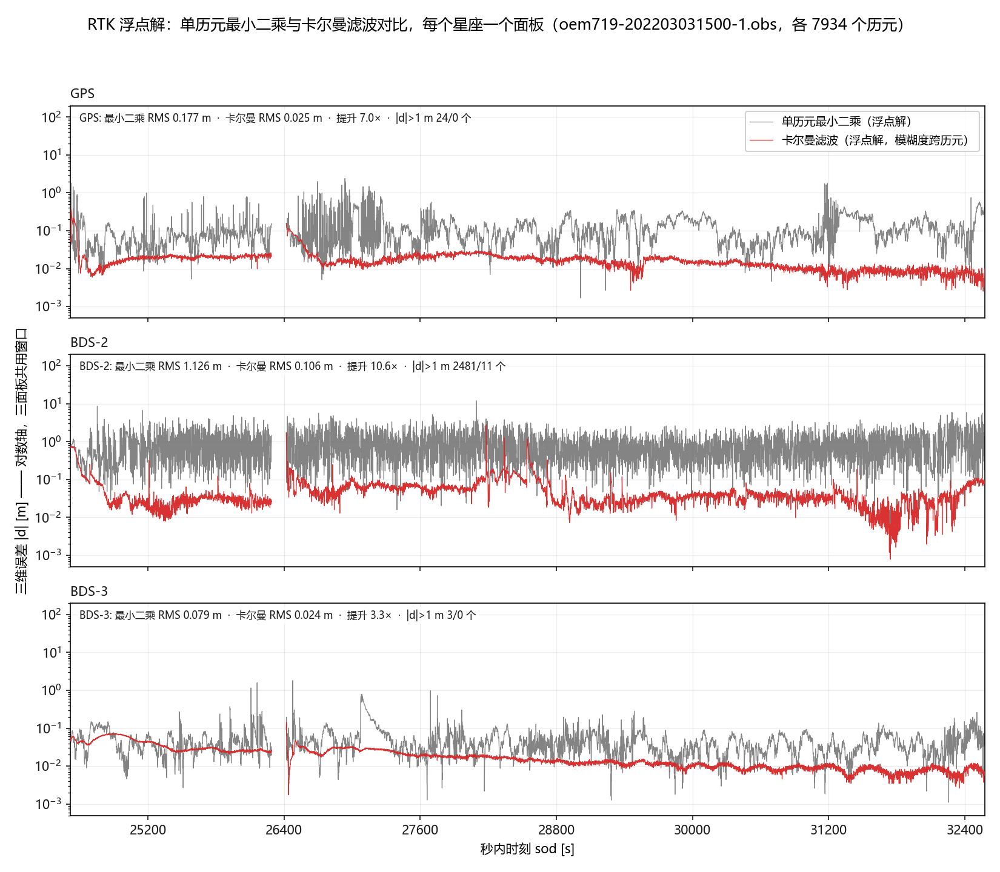

**图 8-6**　灰 = 单历元最小二乘浮点解，红 = 卡尔曼滤波浮点解；纵轴线性、三面板共用图 8-1
的窗口（灰带到图 8-1 里就是 RTK 那条线的高度，到图 8-4 里就是灰色带的高度，三张图可以叠着
读）。面板左上角是本星座两条线的三维 RMS 与提升倍数。注意灰红间距在开头一千多个历元里很窄、
随后才迅速张开——那就是第 4 条说的收敛暂态。

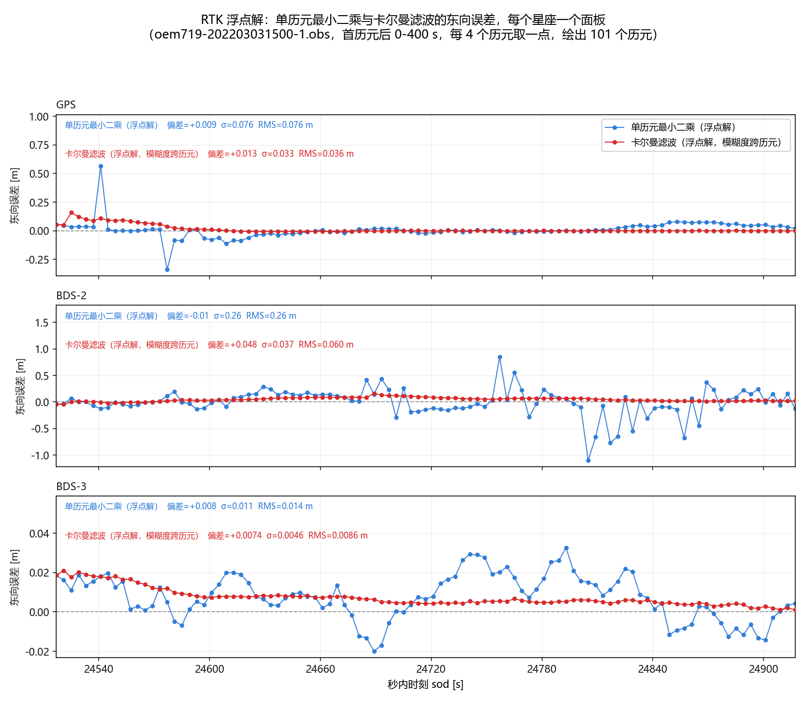

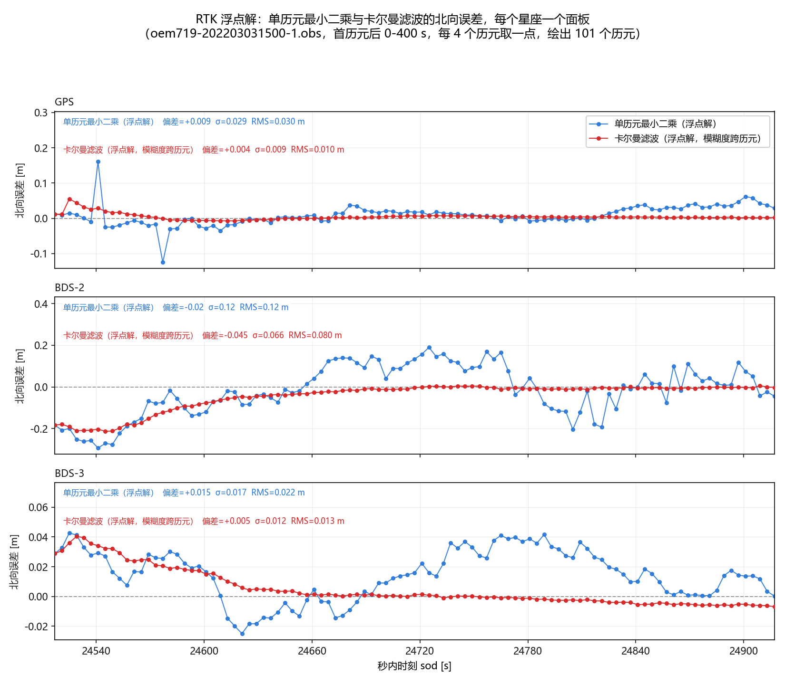

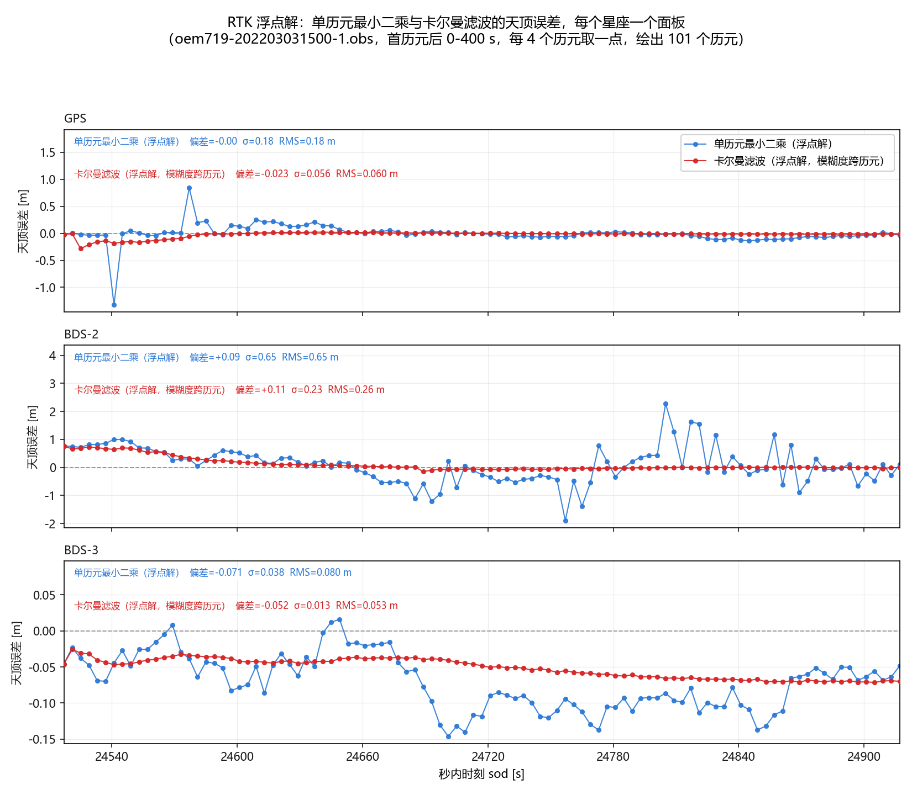

**图 8-6b / 8-6c / 8-6d**　图 8-6 的**放大版**，三张依次是东向 / 北向 / 天顶：只取**开头
400 s**（**101 个历元，每 4 个取一点**）。蓝 = 单历元最小二乘，红 = 卡尔曼滤波；两条仍然同
面板、共用一根纵轴，因为这里的间距本身就是结论（"在收敛"就是间距在合拢）。

**这一组之所以要三张，是因为在这份数据上，卡尔曼的收敛是一个"垂直方向"的现象。** 北斗二号
滤波器前十个历元的中位误差：**东向只有 −0.01 m**、北向 −0.21 m、**天顶 +0.68 m**。也就是说，
**只看 8-6b（东向）会得出"北斗二号根本没有收敛过程"这个错误结论**——它东向的起跑偏移比它自己
稳定后的噪声（这一窗的 RMS 0.060 m）还小，没有东西可收敛。要看收敛过程得看 **8-6d（天顶）**：
红线从 +0.68 m 平滑衰减到零，就是那一段。成因是几何——北斗二号是 IGSO 星座，垂直方向观测性
最弱，而滤波器初始协方差在 ECEF 里各向同性，于是"被拉回来得最慢"的方向正好落在天顶。**一张
把三个分量合在一起的图同样说不了这件事**：北斗二号自己三个分量的窗内 RMS 就相差 11 倍。

| 窗内 RMS（开头 400 s，101 个历元） | 东向 | 北向 | 天顶 |
|---|---|---|---|
| GPS：最小二乘 / 卡尔曼 | 0.076 / 0.036 | 0.030 / 0.010 | 0.177 / 0.060 |
| 北斗二号：最小二乘 / 卡尔曼 | 0.259 / 0.060 | 0.121 / 0.080 | 0.654 / 0.257 |
| 北斗三号：最小二乘 / 卡尔曼 | 0.014 / 0.009 | 0.022 / 0.014 | 0.080 / 0.053 |

（单位 m。窗内提升：东向 2.1× / 4.3× / 1.6×、北向 2.9× / 1.5× / 1.6×、天顶 2.9× / 2.6× /
1.5×；整段 7934 个历元的提升是 7.0× / 10.6× / 3.3×，见第十节表格。两组数一起看才完整：
只有整段数会抹掉暂态，只有窗内数又对不上那张表。）

**这一组就是为收敛暂态画的。** 图 8-6 横跨 2.2 小时，那段暂态在里面只有一个像素宽——第四节
第 4 条说"只看全历元 RMS 会低估它"。撑开之后：GPS 的红线（天顶）从 0.36 m 附近降到历元 100
往后的 0.02 m，北斗二号从 0.68 m 降到 0.05 m，两条**收敛曲线**的形状都看得见了。**北斗三号
是个例外，这一组也把那个例外画出来了**：它三个方向都没有"降到零"的过程（天顶那条是一路缓慢
下探，从 −0.03 m 到 −0.07 m），是三个里收敛最慢、这一窗内收益也最小的。

上表的「浮点 3D-RMS」是全程 7934 个历元的统计。**同一个统计量只取后半程**（后 3967 个历元，
sod ≥ 28612）再算一遍，数字是这样：

| 配置 | LSQ 后半程 3D-RMS | Kalman 后半程 3D-RMS | 后半程提升 |
|---|---|---|---|
| GPS | 0.166 m | 0.0128 m | 13× |
| 北斗二号 | 1.043 m | 0.0406 m | 26× |
| 北斗三号 | 0.050 m | 0.0100 m | 4.9× |

两个窗口差这么多，是因为滤波器有一段收敛暂态（第 4 条）。取「后一半」而不是某个拟合出来的
收敛点，是为了这个窗口不随数据变动；统计量与前表**完全相同**——ENU 三维 RMS
（`sqrt(mean |d|²)`），而**不是中位数**。中位数会把暂态和长尾一起藏起来，两个窗口的差别看起来
会小得多。

四条结论：

1. **收益全在浮点解上：全历元浮点 3D-RMS 提升 3–11 倍，收敛后的后半程是 5–26 倍。**
   这正是教材 8.3.4 的论点：跨历元绑模糊度，才让相位真正约束坐标。固定解**一个数字都没变**
   （本来就该如此，两条路收敛到同一批整数）。两个窗口差这么多，原因见第 4 条。
2. **这纠正了我在第八节末尾的判断。** 那里我说"固定解已经到毫米级，卡尔曼没有收益空间"
   ——那只对固定解成立。第八节的问题是**单历元浮点解的精度被伪距坐标锁住**，而滤波器
   正是解开这把锁的东西。
3. **长尾被削平**：`|d|>1 m` 的历元从 24→0、2481→11、3→0。零基线上最坏历元的浮点解
   原本是米级（伪距限的），滤波器把它压到厘米级。这一条在图上三种星座是**三种不同的形状**：
   GPS 与北斗三号是真正的"尾巴"（0.3% 与 0.04% 的历元越过 1 m，且是孤立尖峰），北斗二号
   则不是尾巴而是**整条带子都在 1 m 附近**（31% 的历元越过 1 m，散布全程）——滤波器对前两者
   是削尖峰，对它是把整条带子往下拉。
4. **滤波器有一段收敛暂态，只看全历元 RMS 会低估它。** 图 8-6 把这件事画了出来：北斗三号
   前约 1500 个历元几乎没有收益（分段 RMS 比 1.2–2.0），1500 历元之后稳定在约 5 倍；
   GPS 在约 2000 历元后才起来（分段比 2.7→4.7→5.1→2.9→11.5），后半程 13 倍。所以
   「提升几倍」必须先说清窗口——同一批数据、同一个统计量，全历元是 3–11 倍，后半程是
   5–26 倍。这不是缺陷：初值协方差取 9e10（`SolverKalman.cpp`），观测需要若干个历元才能把
   状态拉住。图上另有一处与滤波器无关、是数据本身的性质：sod 26291 起有 129 秒的接收机
   掉线缺口，缺口之后三条红线都要重新收敛一段（北斗二号 500–1500 段那 41 倍是全程最高，
   2000–4000 段掉到 8.5 倍再慢慢回到 26 倍，就是这个缺口在起作用）。

北斗二号的固定率**没有提高**（81.8% vs 82.1%，几乎相同）——滤波器改善的是浮点解和长尾，
不是 ratio 检验本身。这一点与先前"卡尔曼能把北斗二号那 17.9% 拉回来"的预期不符，实测
如此。

### 10.4 第一版崩了，原因不在滤波器

第一次跑 `bds3`：稳定跟踪 13 mm、持续 2076 个历元，在 sod **26538** 一步跳到 14 m，
此后再不恢复（全量浮点 3D-RMS 17.5 m、ratio 中位数 1.04）。

**一个过期模糊度会被以零过程噪声一路带下去，永不恢复**；最小二乘每历元重算，天然免疫。
而 `bds3` 当时**一个周跳标志都产生不了**——探测器的频点对写死是 B1I/B2I，看不见 B2a。

三个模式的相关性完全一致：有计划标志的（GPS、北斗二号）提升十倍且稳定，没有的（北斗三号）
崩。把探测器的频点对改成**按系统可覆盖的候选表**之后：

- 四种模式的模糊度标志覆盖率全部 100%（`bds3` 从 0 个有标志的历元变成 267 个）
- `bds3` 卡尔曼：RMSE **0.0240 m**、固定率 **100%**、**0 个历元超过 1 m**，
  sod 26538 附近的 |d| 一路 0.02–0.03 m

第 7 章那几个程序的输出**逐字节未变**（默认不覆盖时用的还是原来那张表，实测对拍过）。

### 10.5 复现

```bash
SP3="data/COD21994.EPH"   # CODE 精密轨道（不含北斗）
CLK="data/COD21994_rnx3.CLK"   # 对应的精密钟差（RINEX 3.02）
TRUE="-2267803.4464,5009342.4841,3220991.0095"
# 卡尔曼（约 40 秒一个配置），写到单独一棵树里，别和最小二乘那批混在一起
./build/bin/rtk config/rtk.ini --sys gps  --estimator kalman --fix --trop --sp3 $SP3 --clk $CLK --base-xyz $TRUE --out-dir output/rtk-kalman/full
./build/bin/rtk config/rtk.ini --sys bds2 --estimator kalman --fix --trop --bds-tgd --base-xyz $TRUE --out-dir output/rtk-kalman/full
./build/bin/rtk config/rtk.ini --sys bds3 --estimator kalman --fix --trop --bds-tgd --base-xyz $TRUE --out-dir output/rtk-kalman/full

# 看周跳标志覆盖率（卡尔曼路径下这本身就是必跑的）
./build/bin/rtk config/rtk.ini --sys bds3 --dump-cs

# 图 8-6：把两棵树一起交给 rtk-plot
gnss rtk-plot --out-dir output/rtk/full --kalman-out output/rtk-kalman/full --lang zh
```

**必须分两棵树，而且卡尔曼那棵不能放在 `output/rtk` 里面。** `apps/rtk.cpp` 对两种估计器
写的是**同一个文件名** `<rover>_<sys>_rtk_float.out`（这个名字被逐字节回归测试钉住了，
估计器只记在 manifest 里），所以同一个目录里两种估计器会互相覆盖；而 `rtk-plot` 的
`--out-dir` 是**递归**搜索、同一个星座「长的赢」，把卡尔曼藏在里面会让它悄悄顶掉最小二乘的
输出而且不报错。`--kalman-out` 的那棵树配不上对时只警告不失败。

---

## 十一、习题 3：双差观测值的相关性（`Q_DD = C·Q_SD·Cᵀ`）

### 11.1 上游把这道题留在代码里

`differenceSat()` 给每条双差取权时，走的是「两个单差的方差相加」：

```cpp
double varDiff = 1.0/weightCurrent + 1.0/weightDatum;
equDataDD[ed.first].weight = 1.0/varDiff;
```

这等于假设**双差彼此独立**。但同一观测类型下的所有双差都是「非基准星减基准星」，
**共享基准星的那一个单差**，所以两两之间存在协方差 `q_datum = 1/w_datum`。上游作者把
这一点连同这道题一起留在了注释里：

```cpp
//
// todo
// 构建完整的方差协方差阵，并比较定位结果的不同
```

本节就是把那个 todo 做完，并回答它问的那句话——**比较定位结果的不同**。

### 11.2 严格形式与它的结构

站间差分之后 `Q_SD` 确实是对角的（两台接收机彼此独立），第 i 个单差的方差就是 `qᵢ = 1/wᵢ`。
星间差分是线性算子 `C`（非基准星 − 基准星），于是严格形式就是本题的标题：

```
Q_DD = C · Q_SD · Cᵀ
```

它**按观测类型分块**：同一类型内 `Q = diag(q_s) + q_datum·11ᵀ`，跨类型为零（不同频点的
单差是彼此独立的观测）。块很小（块边长 = 卫星数 ≤ 8），直接求逆即可。注意它的**对角线
恰好等于**原来那条「方差相加」的权——补上的只有非对角项。

实现上只加了一处状态：`EquSys::obsCov`。**空矩阵 = 各观测独立 = 本仓库原有的路径**，
所以每一个逐字节锚点都没有动，`--dd-cov` **默认关**。两个解算器（`SolverLSQ`、
`SolverKalman`）各加一行：`obsCov` 非空时用它求逆当权阵。**`fixSolution` 与 LAMBDA
一行都没改**——它们本来就在吃完整的 `Q_N`，相关性自己就传下去了。

### 11.3 结果：影响在 5–12%，一个判定都没翻

章节的零基线（7934 历元、与第四到十节同一套 `--trop --base-xyz` 配置），同样的两棵树，
只是其中一棵多一个 `--dd-cov`，对**真位置**衡量：

| 星座 | 浮点 3D-RMS 独立 → 相关 | ratio 中位数 | 过阈值历元 | 固定率 | 固定 3D-RMS | SPP 3D-RMS（对照） |
|---|---|---|---|---|---|---|
| GPS | 0.1774 → **0.1876** m | 509.8 → 451 | 7934 → 7934 | 100.0% → 100.0% | 0.0180 → 0.0180 m | 2.844 m（不动） |
| 北斗二号 | 1.1264 → **1.1912** m | 102.4 → 92 | 6511 → 6511 | 82.1% → 82.1% | 0.0304 → 0.0300 m | 13.502 m（不动） |
| 北斗三号 | 0.0791 → **0.0725** m | 1286.6 → 1336 | 7934 → 7934 | 100.0% → 100.0% | 0.0114 → 0.0113 m | 3.124 m（不动） |

四点读法：

1. **SPP 那一列一个数字都没变**——它是差分之前算出来的，与双差怎么加权无关。这是一个
   干净的对照组：它没动，说明变的确实是差分之后那一步，而不是别的东西。
2. **浮点解动 5–8%，方向还不一致**（GPS 与北斗二号略差、北斗三号略好）。理论预期的量级是
   `~1/n`（n = 6–8 颗星），实测正是这个量级。
3. **ratio 中位数动 5–12%**，这是相关性最直接的落点：LAMBDA 吃的就是模糊度协方差 `Q_N`。
4. **固定判定一个都没翻**：三个星座的固定率一字不变，固定解 RMS（0.0180→0.0180、
   0.0304→0.0300、0.0114→0.0113 m）与「已接受的最坏误差」（0.0390→0.0399、0.0819→0.0814、
   0.0193→0.0186 m）也都只动毫米。原因是每个历元的 ratio 都在阈值 3.0 之上**两三个数量级**
   ——余量太大，5–12% 摇不动它。

所以这道题的答案是**负面的、但不是空的**：在这个数据集上，"把双差当独立"这个简化的代价
是 5–12% 的浮点精度与 ratio 幅度，**而不是任何一次错误的固定**。理论说这一条对**固定解**
的影响应该比对浮点解更大（LAMBDA 吃的就是 `Q_N`），实测里之所以看不出来，正是因为
ratio 的余量太大——**结论不能外推到低仰角、短弧段或可见星少的场景**：那里 `n` 小、
`q_datum` 占比大，`1/n` 的效应会跟着变大。

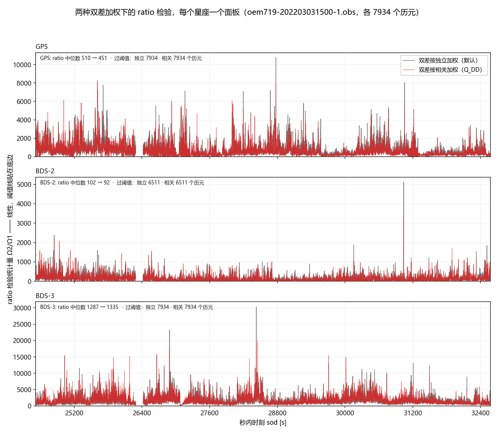

**图 8-7**　灰 = 双差按独立加权（默认），红 = 按相关加权（`Q_DD`）；纵轴是 ratio 检验
统计量 `Ω2/Ω1`（教材式 (8.61) 的 Ratio，次优解与最优解的残差平方和之比），**线性**、
每面板独立标度；虚线是阈值 3.0——ratio 本身在几百到几千的量级，所以它与底边重合，
**读阈值要看面板注记里那个过阈值历元数，不是看那条线**。两条线几乎处处重叠，**这个
重叠本身就是结论**：红画在灰之上、细一圈，否则灰线会被完全盖住。ratio 为 0 表示"没有
整数候选"，图上留空隙而不是画成 0。

### 11.4 复现

```bash
# 与第十三节同一批配置，只多一个 --dd-cov，落到兄弟目录
./build/bin/rtk config/rtk.ini --sys gps  --fix --trop --sp3 $SP3 --clk $CLK --base-xyz $TRUE --dd-cov --out-dir output/rtk-ddcov/full
./build/bin/rtk config/rtk.ini --sys bds2 --fix --trop --bds-tgd --base-xyz $TRUE --dd-cov --out-dir output/rtk-ddcov/full
./build/bin/rtk config/rtk.ini --sys bds3 --fix --trop --bds-tgd --base-xyz $TRUE --dd-cov --out-dir output/rtk-ddcov/full

# 图 8-7：把两棵树一起交给 rtk-plot（哪边是相关加权由 manifest 的 ddCov 决定，不靠参数顺序）
gnss rtk-plot --out-dir output/rtk/full --dd-cov-out output/rtk-ddcov/full --ref-xyz="$TRUE" --lang zh

# 看一个历元的 Q_DD（示例程序，不需要数据）
./build/bin/diff_station --dd-cov
```

**测试**：`python tests/test_rtk_equations.py` 用手算算例钉住矩阵（3 星 2 频点、权重
0.25/0.5/1 → `Q_DD = [[8,0,5,0],[0,8,0,5],[5,0,7,0],[0,5,0,7]]`），并断言**对角线与不开
开关时逐位相同**；`tests/test_rtk_plot.py` 钉住配对（哪边是相关的那边从 manifest 读）
与图 8-7 的确定性。

---

## 十二、尚未做的与已知局限

**没做**（下一批）：

- **GPS + 北斗的跨星座混解**。`differenceSat` 的基准星是**全局唯一**的，而混解要按星座
  各选一颗——这是第四节开头那句"一次只能解一个星座"背后的实际缺口。
- **北斗精密产品：产品下到了，卡在 DCB。** 含北斗的 MGEX 产品（GFZ `GBM0MGXRAP_20220620000_…`）
  已在 `data/`，读入器直接认，但**直接换进去北斗两列反而更差**（北斗三号 SPP 3.124 → 6.176 m，
  北斗二号 13.502 → 20.751 m），而同一份产品解 GPS 正常（2.878 m vs CODE 的 2.844 m）。
  根因是钟差基准/码间偏差不匹配——GFZ 的北斗钟差按 B1I/B3I 组合定基准，与广播的 B3I+TGD
  差一个**逐星 DCB**（散布同时变大就是判据）。修它要先写一个 **SINEX-BIAS / OSB 读入器**
  并把偏置挂到逐卫星码观测上，见第四节末的实测表。

**已知局限**：

- **那 19–28 m 的偏移查清了：是接收机报的那个表头坐标，不是解算。** 两台接收机报出的表头
  互相只差 **0.070 m**，却一致地离天线 **24.9 m**。判据：同一套解算在有 IGS 官方坐标的
  2025 年数据上是 **1.06 m**（3-D RMS 4.94 m）；两台接收机用精密轨道与钟差各自解算，
  整段均值互差 **0.020 m**；广播解与精密解互差 **1.70 m**。用 `rtk --base-xyz <真值>`
  之后，SPP 三维 RMS 从 21.4 / 33.4 / 25.0 m 落到 **11.3 / 18.7 / 9.1 m**；再打开
  `--trop` 与 GPS 的精密产品，就是第四节表里的 **2.844 / 13.502 / 3.124 m**。
  **数据文件保持接收机报的原值不动**——字节锚点就是那样跑出来的，而"接收机报了个偏 25 m
  的坐标"本身是该留着的事实。
- **SPP 那一列剩下的误差主要是它自己的慢漂移，不是常数。** 按 1/8 段取均值，GPS 的垂直
  误差八段依次是 −1.3、−1.6、−1.6、−3.0、−0.8、+0.5、+3.4、+4.3 m——**首尾差 5.6 m、
  起伏 7.3 m**，而同一列逐历元的垂直 σ 只有 0.38 m：所以「残余」主要是漂移而不是噪声。
  这也正是「去均值后残余比 16× / 9× / 35×」与「逐历元比 3.7× / 5.1× / 3.3×」这两个数
  差得远的原因——后者才是噪声对噪声。**下一个该查的是这条漂移**：精密产品只能压掉它约
  一半（2025 年那套：3-D RMS 8.68 → 4.94 m），另一半还没有来源。
- **`--trop` 对 SPP 那一列是实打实的收益。** 早先"补上对流层改正反而更差"的结论是拿错的
  基准量出来的，不成立：用真值衡量，加上它 SPP 三维 RMS 从 11.3 / 18.7 / 9.1 m 降到
  **9.2 / 13.5 / 3.1 m**（GPS 再叠加精密轨道与钟差就是表中的 2.844 m），均值偏差从
  7.1 / 5.5 / 4.1 m 降到 **1.0 / 9.4 / 1.7 m**（北斗二号那 9.4 m 是它自己的几何问题，
  见第五节）。**本章的表与图一律用带 `--trop` 的配置**（第四到十一节同一口径）；
  只有逐字节锚点那条测试跑的是不带它的命令（第七节）。
- 零基线（见第四节末）：结论不能外推到普通基线。
- 上一条顺带的推论：**在零基线上，「绝对解」的任何逐卫星误差都会被双差吃掉**，
  所以本章的 RTK 结果再准也**不能用来验证卫星轨道、钟差或传播改正**——
  它验证的是相对几何。要验证绝对那一层，需要非零基线或精密产品。
- BDS-2 与 BDS-3 的接收机钟差系统差与**卫星钟差基准**只做了一半：本节的三种配置
  各自都是单代，所以这个问题没暴露；跨代混解见第九节。
- `SolverLSQ::getSolution` 原先在**解引用之后**才检查是否越界（空未知数集合会
  解引用 `end()`），`getIndex` 找不到变量时返回 `varSet.size()` 并被当作列号写进
  `hMatrix`（越界写）。两处都已改成抛异常，对合法输入行为不变。

---

## 十三、复现方法

```bash
SP3="data/COD21994.EPH"   # CODE 精密轨道（不含北斗）
CLK="data/COD21994_rnx3.CLK"   # 对应的精密钟差（RINEX 3.02）
TRUE="-2267803.4464,5009342.4841,3220991.0095"
# 构建
scripts/build.sh

# 树 1：单历元最小二乘（默认估计器），零基线、完整两小时、约 25 秒一个。
# 带 --fix：它同时写出浮点解与固定解（同一批历元，两个文件），图 8-1…8-5 都来自这棵树。
./build/bin/rtk config/rtk.ini --sys gps  --fix --trop --sp3 $SP3 --clk $CLK --base-xyz $TRUE --out-dir output/rtk/full
./build/bin/rtk config/rtk.ini --sys bds2 --fix --trop --bds-tgd --base-xyz $TRUE --out-dir output/rtk/full
./build/bin/rtk config/rtk.ini --sys bds3 --fix --trop --bds-tgd --base-xyz $TRUE --out-dir output/rtk/full

# 树 2：卡尔曼（第十节），图 8-6 的另一半。
# 必须是 output/rtk 的兄弟目录，不能放在它里面——两种估计器写同一个文件名，
# 而 --out-dir 的搜索是递归的，「长的赢」会把这件事藏起来。详见第 10.5 节。
./build/bin/rtk config/rtk.ini --sys gps  --estimator kalman --fix --trop --sp3 $SP3 --clk $CLK --base-xyz $TRUE --out-dir output/rtk-kalman/full
./build/bin/rtk config/rtk.ini --sys bds2 --estimator kalman --fix --trop --bds-tgd --base-xyz $TRUE --out-dir output/rtk-kalman/full
./build/bin/rtk config/rtk.ini --sys bds3 --estimator kalman --fix --trop --bds-tgd --base-xyz $TRUE --out-dir output/rtk-kalman/full

# 快速对拍（25 历元的锚点窗口）
./build/bin/rtk config/rtk.ini --sys gps --stop 2022-03-03T06:49:00

# 调试单个历元：打印双差方程组的残差、系数、权重与状态向量
./build/bin/rtk config/rtk.ini --sys gps --dump-epoch 24524 --verbose

# 测试
python tests/test_rtk_float_regression.py    # 需要 data/Zero-baseline/（未入库）
python tests/test_rtk_equations.py           # 不需要数据，CI 可跑
python tests/test_rtk_plot.py                # 出图那条路，不需要数据

# 树 3：习题 3 的相关加权（第十一节），同样必须是自己的兄弟目录
./build/bin/rtk config/rtk.ini --sys gps  --fix --trop --sp3 $SP3 --clk $CLK --base-xyz $TRUE --dd-cov --out-dir output/rtk-ddcov/full
./build/bin/rtk config/rtk.ini --sys bds2 --fix --trop --bds-tgd --base-xyz $TRUE --dd-cov --out-dir output/rtk-ddcov/full
./build/bin/rtk config/rtk.ini --sys bds3 --fix --trop --bds-tgd --base-xyz $TRUE --dd-cov --out-dir output/rtk-ddcov/full

# 出图与数字表（本文十六张图即由这一行生成，图片与文档同为中文）。
# --ref-xyz 是必须的：不给它，参考坐标就退回基准站表头（那个偏了 24.9 m 的值），图和表都对不上。
gnss rtk-plot --out-dir output/rtk/full --kalman-out output/rtk-kalman/full \
              --dd-cov-out output/rtk-ddcov/full --ref-xyz="$TRUE" --lang zh
```

示例程序（不需要数据，交互式）：

```bash
./build/bin/diff_station        # 站间/星间差分的两个例子，一个良态一个秩亏
./build/bin/sync_obs            # 两颗接收机的历元对齐（含基准站超前的情形）
```
